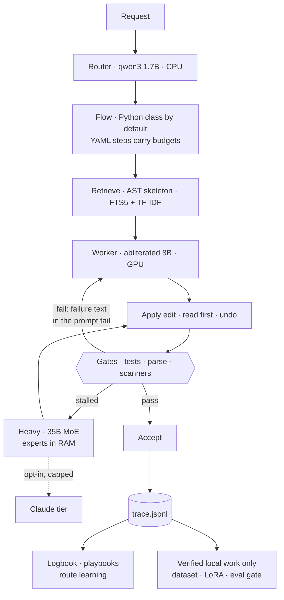
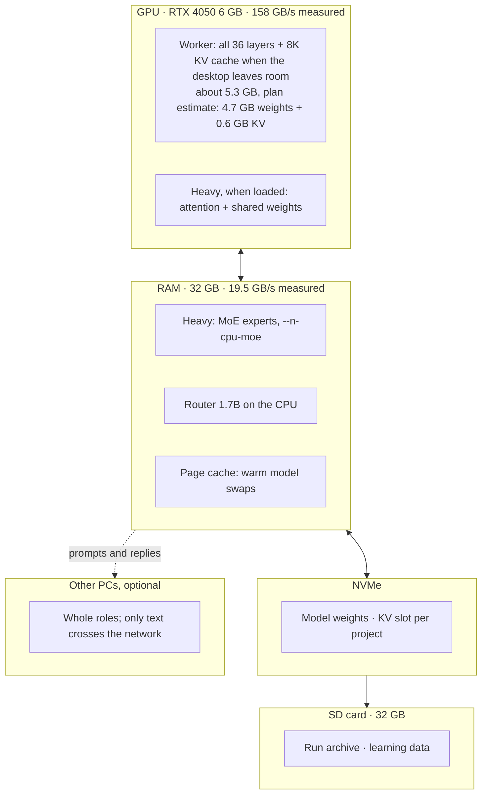
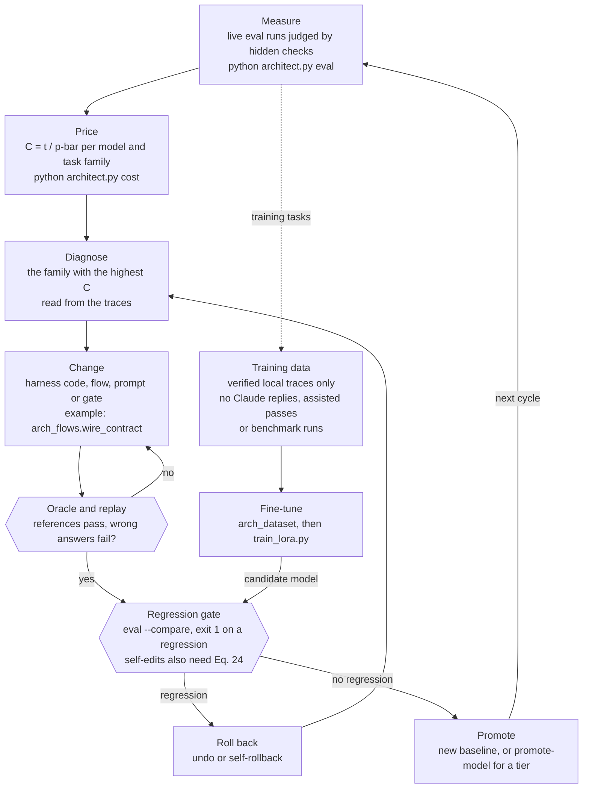

# Local Architect

**A local agentic coding harness for orthogonalized small language models, built around one measured quantity: the expected time per accepted change.** The model proposes; code decides.

Python 3.10+ · standard-library core · offline by default · runs on a 6 GB laptop GPU ·
[technical report](docs/research/README.md) · [architecture](docs/ARCHITECTURE.md) · [report vs code](docs/research/IMPLEMENTATION_STATUS.md)

## Abstract

Local Architect is the reference implementation of the technical report *Engineering Local Agentic Coding Harnesses with Orthogonalized Small Language Models* (Vieni, 2026). It runs an agentic coding loop (retrieve context, propose an edit, verify, retry) offline on consumer hardware. The reference machine is a laptop with a 6 GB GPU. The design has three parts. First, small models whose refusal direction has been projected out of the weights, $P = I - \hat r \hat r^\top$. The aim is to stop false-positive refusals from halting an unattended loop. The harness runs such weights; the projection itself is done elsewhere and is not in this repository. Second, a deterministic harness. Tests, parsers and scanners decide what is kept, every edit can be undone, and a check that cannot run returns *not sure*, never a pass. Third, a design model that treats GPU memory, RAM, storage and the network as one memory hierarchy. It judges each decision by the expected time per accepted change, $C = t/\bar p$. Twenty of the report's 24 numbered equations are in the code. Early measured readings (3 to 6 tasks per cell) give $C$ from 38.3 to 145.6 s per passed task. On one task family, the model that is fastest per task costs more per accepted change than a slower model that passed all 3 of its tasks (107.9 s against 58.8 s). No model has yet passed a whole-project build. The report's evaluation of 14B and 32B models is specified and has not been run.

## Contributions

1. **Verification decided by code, with three outcomes.** Code accepts or rejects every change. It uses the gates registered in `arch_gates.GATES`, plus `arch_checks` and `arch_fakecode`. A gate answers True, False or None. None means the check could not run. The run's verdict is then `not_sure`, which never counts as a pass and is never used as a training label. When a judge model gives a verdict, its verdict field is ignored and recomputed in code. Some contract wiring has exactly one correct repair: a missing `__init__.py`, a missing re-export or a missing `__main__.py`. Code makes that repair (`arch_flows.wire_contract`) and traces the try as `assist`, so the harness's share of a pass stays separate from the model's.
2. **A bounded retry loop that detects stalls (Algorithm 1).** Each step has an attempt cap. A run stops at `limits.max_calls` or a STOP file, checked in `Engine.call` before a request is sent; YAML-defined steps can also carry a `{calls, tokens, seconds}` budget. Prompts are prefix-stable: failure text goes last, so a retry reuses the cached prefix (Eq. 15). `arch_selftest_chain` fails a retry template in the Python flow modules that breaks this and `arch_selftest_promptprefix` checks the 47 YAML prompt files. Retrieval fuses SQLite FTS5 and TF-IDF rankings by reciprocal rank (Eq. 23, `arch_index.rrf`). `arch_progress.Coach` fingerprints replies and failures and sorts each attempt into one of four stall states, a superset of Eq. 22. A stalled step moves to a larger local model only when `arch_progress.ready_now` predicts an answer within `limits.escalate_max_s` (default 240 s). Otherwise the next try starts fresh at a higher temperature.
3. **A hardware model with measured parameters.** Memory fit (Eq. 4–5) is computed in `arch_modelmath.fit` and `arch_server.plan`. `arch_modelmath.fit` also computes the decoding bound over GPU and RAM (Eq. 6–7). It uses bandwidths that `arch_hw.bandwidth_from` derives from timed runs on the machine. On the reference laptop these are GPU 158 GB/s and RAM 19.5 GB/s (measured). Without a measurement it falls back to estimates and labels them as estimates. Mixture-of-experts tiers keep expert tensors in RAM and attention and shared weights on the GPU (`arch_server._moe_split`). The `arch_chain` ledger records each model swap (Eq. 9–10).
4. **The loop model as a measurement.** `arch_costmodel` computes $\bar p$ and $C = t/\bar p$ (Eq. 16–17) per model and task family. It reads run traces and saved eval reports (`p_bar`, `cost`, `measure`, `from_evals`). The results are reported by `python architect.py cost` and by the hub page **Models > Cost map**. Eq. 15, 18 and 19 are tested calculators (`call_time`, `run_time`, `planner_pays`). The self-test of `planner_pays` reproduces the report's worked example: 150 s > 110.8 s, so moving the planner pays. The person still chooses role placement; it is not solved from Eq. 18.
5. **An evaluation protocol with an oracle, a regression gate and separated data.** `evals/` holds a fixed benchmark of 105 tasks plus 4 whole-project builds, and 105 training tasks. Each task is judged by code the model never sees. Most tasks carry a reference solution and a deliberately wrong one. The scripted oracle (`eval --fake`) shows that the reference passes, and a wrong-answer run shows that the checks catch the mistake. `eval --compare` (`arch_eval.compare`) exits 1 on a regression in any flow. By default a regression is a pass-rate drop of more than 5 points, a rise in median tokens of more than 25 percent, or a rise in 95th-percentile time of more than 40 percent. `arch_eval.keep_trace` files each live run under `train` (training tasks that are not held out) or `bench` (everything else). `arch_dataset` reads only `train`, so benchmark tasks never become training data. The same protocol can compare a base model with its orthogonalized version. That is the pass-rate half of the report's deployment gate (§2.4); no such pair has been measured yet. The over-refusal half is specified, not built.
6. **Gated learning and gated self-modification.** `arch_dataset` exports SFT samples, verifier-labelled preference pairs and tool trajectories from local traces. It drops Claude-written replies, passes that needed `wire_contract`, and tries whose checks could not run. A QLoRA script, `train_lora.py`, can train an adapter on that export. It needs third-party packages, and its training step has not been run on the reference machine. `promote-model` switches a tier to a new model only when `eval --compare` shows no regression. The harness can also edit its own code in a throwaway copy. `arch_selfimprove.gate` passes such an edit only if all of these hold:
   - it compiles;
   - it adds no fake code;
   - it passes the full self-test suite;
   - it runs at least as many checks as before (Eq. 24);
   - it shows no eval regression.

   The person then confirms the promotion, and a zip backup allows a one-step `self-rollback`.

## Architecture



In a YAML flow (`flows/*.yaml`) each step is data: a tier, a prompt file, its gates, retries and a `{calls, tokens, seconds}`
budget, enforced in `Engine.call` before a request leaves. Those step budgets apply under `flows.engine = data`, to flows that
exist only as YAML, and to local agents. Under the default engine (`legacy`) the main flows run as Python classes and stop at
`limits.max_calls` (60 calls) or on a STOP file. A gate answers **True**, **False** or **None**. None means "could not run" and
is never counted as a pass or used as training data. Failure feedback always goes at the end of the prompt, so the stable prefix stays in the KV cache across
retries.

### Where the bytes live



## The design model

The report's equations are implemented in the code. Each one comes with its parameters measured on this machine.

**Memory fit.** A model fits on the card only if its weights, its KV cache and the runtime overhead fit together:

$$\kappa = 2 L h_{kv} d_h b, \qquad M + \kappa n + O \le V \quad\Longrightarrow\quad n^{\ast} = \left\lfloor \frac{V - O - M}{\kappa} \right\rfloor$$

**Decoding is bandwidth-bound.** Each token reads every active weight and its cache once, from wherever they live:

$$t_{tok} \approx \sum_{\tau \in \lbrace \text{gpu},\ \text{ram},\ \text{disk} \rbrace} \frac{D_\tau}{B_\tau}, \qquad \sum_\tau D_\tau = M_{\text{active}} + \kappa \bar n$$

**Call time with a cached prefix.** ρ is the share of the prompt served from the KV cache:

$$t = (1-\rho) \frac{n_{in}}{r_p} + n_{out}  t_{tok}$$

**Time per accepted change.** This is the quantity a model is judged by. It uses the attempt-weighted pass rate $\bar p$ over
attempts $1, \dots, k$:

$$C = \frac{t}{\bar p}, \qquad \bar p = \frac{\sum_{i=1}^{k} Q_{i-1}  p_i}{\sum_{i=1}^{k} Q_{i-1}}, \qquad Q_i = \prod_{j \le i} (1 - p_j)$$

**Placing roles.** For role counts $c_r$, swaps $S$ and swap cost $\lambda$, moving the planner from a small model $s$ to a large
model $\ell$ pays only when the builder time it saves exceeds the planner time it adds:

$$J = \sum_r c_r \frac{t_r}{p_r} + \lambda S, \qquad c_b  t_b \left(\frac{1}{p_b} - \frac{1}{p_b'}\right) > c_r \left(\frac{t_\ell}{p_\ell} - \frac{t_s}{p_s}\right) + \lambda  \Delta S$$

**Loop control, retrieval and self-improvement.** A step is stalled when it repeats itself. Retrieval rankings are fused by
reciprocal rank. A self-edit is promoted only when every gate passes and no checks were removed:

$$\text{stalled} \iff h_i = h_{i-1} \ \lor\ f_i = f_{i-1} \ \lor\ h_i = h_{i-2}$$

$$\mathrm{RRF}(d) = \sum_j \frac{1}{60 + \mathrm{rank}_j(d)}$$

$$\text{promote } H' \iff \mathrm{Gates}(H') \land \lvert \mathrm{checks}(H') \rvert \ge \lvert \mathrm{checks}(H) \rvert$$

| Equation | Where it runs | Measured on the reference laptop |
|---|---|---|
| Fit (4–5) | `arch_server.plan`, `arch_modelmath.fit` | abliterated 8B: all 36 layers + 8K window planned on the 6 GB card (plan estimate, about 5.3 GB) |
| Decode (6–7) | `model_hub.fit_model`, `arch_hw.bandwidth_from` | GPU 158 GB/s, RAM 19.5 GB/s |
| Prefix reuse (15) | prefix-stable prompts, llama-server `cache_n`, KV slots on disk | ρ recorded per call; edits 56 → 306–343 tok/s with n-gram speculation |
| Cost (16–17) | `arch_costmodel`, `python architect.py cost`, hub **Models → Cost map** | see the table below |
| Placement (18–19) | `arch_costmodel.planner_pays`, `cost --planner` | the report's worked example is a self-test: 150 s > 110.8 s pays |
| Stall (22), fusion (23), promotion (24) | `arch_progress.Coach`, `arch_index.rrf`, `arch_selfimprove.gate` | built and self-tested |

**C on this machine** (from `python architect.py cost` over live eval runs, per family of tasks; 3–6 tasks per row, so read these
as early readings). In the hub: **Models → Cost map**, where you can click any point to see the tasks behind it.

| Model | Kind of task | p | t (s/task) | **C (s per passed task)** |
|---|---|---|---|---|
| huihui_ai/qwen3-abliterated:8b | feature | 1.00 | 38.3 | **38.3** |
| huihui_ai/qwen3-abliterated:4b | bugfix | 1.00 | 40.4 | **40.4** |
| qwen3:8b | build | 1.00 | 58.8 | **58.8** |
| huihui_ai/qwen3-abliterated:4b | build | 0.33 | 36.0 | **107.9** |
| all five models measured | whole projects (e2e) | 0.00 | 96–274 | **never passed** |

On `build`, the abliterated 4B is the fastest per task (36 s), but it passes 1 time in 3. So it costs more per accepted change
than a slower model that always passes (108 s vs 59 s). That is why the report ranks models by C, not by tokens per second.
Whole-project builds are where every model stops (0 of 4 each), so that is where the harness has to improve.

**Status against the report:** of 40 items, 21 are built, 17 are partial and 2 are not yet built. The largest gaps are the
orthogonalization procedure itself, layer splits across machines (Eq. 13) and the §9 evaluation. Section by section, with the
code for each: [docs/research/IMPLEMENTATION_STATUS.md](docs/research/IMPLEMENTATION_STATUS.md).

## Iterative flow

Architect changes through two nested loops. The inner loop is one step of a run, the report's Algorithm 1. The outer loop is how the harness and its models are revised between runs. Both loops act on one quantity, the expected time per accepted change $C = t/\bar p$.

### Inner loop: one step of a run

The listing gives Algorithm 1 with the names it has in the code. By default the Python flow classes in `arch_flows*.py` run it (`flows.engine = legacy`). `arch_dataflow.py` runs the same loop for `flows/*.yaml`. Lines 7 and 11 exist only in the build flow.

```text
Algorithm 1  One step of the harness loop, as implemented
Input: goal G, repository R, the step's model m, attempt cap k,
       step budget B = {calls, tokens, seconds}

 1: X <- Retrieve(R, G)                    # AST skeleton (arch_core.focus); FTS5 and TF-IDF fused by arch_index.rrf, Eq. 23
 2: F <- empty; coach <- Coach(role)       # feedback tail; reply and failure fingerprints
 3: for i = 1, ..., k do
 4:     stop if B is spent or a STOP file exists      # checked in Engine.call before the request is sent. Default engine:
                                                      # no step budget B, only the run's limits.max_calls (B binds in YAML flows)
 5:     y_i <- m(Prompt(X, G ; F))                    # stable prefix first, per-try tail F last, Eq. 15
 6:     Apply(y_i)                                    # FILE / EDIT / DEF blocks, each with a backup and an undo
 7:     W <- wire_contract(G)                         # unambiguous wiring only; undone if the import still fails
 8:     v_i <- Gates(step)                            # each gate: True, False, or None = could not run
 9:     Record(y_i, v_i)                              # trace.jsonl; an "assist" record when W is not empty
10:     if v_i passes then return Accept(y_i)
11:     undo y_i if it left the project clearly worse # BestState
12:     F <- failure text of v_i + FAILURE TYPE       # one-line triage by pattern, no model call
13:     s <- coach.observe(H(y_i), H(failure))        # progress, repeat_reply, same_failure, cycling or no_change; Eq. 22
14:     if s != progress then
15:         if ready_now(larger local model) then m <- that model   # HANDOVER note; limits.escalate_max_s
16:         else the next try starts fresh at temperature 0.8       # FRESH ATTEMPT note
17:         F <- F + a hint that names the stall
18:     end if
19: end for
20: return Fail    # at most k model calls; a gate that could not run makes the verdict not_sure; every change stays undoable
```

Past the heavy tier, an opt-in Claude tier with a spending cap can take the step. It is off by default, and its replies are never training data.

### Outer loop: how the harness changes

Each cycle starts from live measurements and ends at a regression gate. For harness changes, the first steps (diagnose, change, oracle, replay) are the project's working method. Code enforces the gate itself in `promote-model` and `self-improve`.



### How the loops relate to C

Both loops act on the two factors of $C = t/\bar p$ (Eq. 17).

Inside a step, prefix-stable prompts keep the cached share $\rho$ near one on retries, which keeps the call time $t$ low (Eq. 15). Feedback, stall detection and escalation aim to raise the pass rate of later attempts, and with it $\bar p$. With a constant pass rate, the cap $k$ bounds the worst case but not the mean (Eq. 16). So a stalled step changes its input or its model instead of repeating the call. If feedback never makes a model worse, $C \le t/p_1$. The gap between $t/p_1$ and the measured $C$ is what feedback is worth.

The outer loop measures $C$ per model and task family. It starts with the family where $C$ is largest or undefined. Whole-project builds are the current case. In the measured runs no model passed one ($\bar p = 0$; five models, 4 tasks each). Many of these failures were in the contract's shape rather than in its logic: an unexported name, or a missing `__init__.py` or `__main__.py`.

`arch_flows.wire_contract` is the change that followed: code fixes the wiring, and the model writes the logic. It targets $\bar p$ without adding model calls. Its self-test rebuilds the miswired outputs seen live and shows the contract check failing before the repair and passing after it. Its effect on live $C$ has not been measured yet. Passes it helped are kept out of training, so no model is credited with work done by code.

A new model must pass `eval --compare` before `promote-model` switches a tier. A self-edit must also satisfy Eq. 24, so measured cost cannot be lowered by deleting the checks that define an accepted change.

## What you get

- **Builds, fixes, tests, refactors, secures and reviews** code through 19 workflows (build, bugfix, feature, test, refactor, secure, ...).
- **Code decides what passes**, not the model: tests, syntax checks, a fake-code detector and scanners gate every change, and every run can be undone.
- **Uses your whole machine**: a small router model on the processor, a fast worker on the graphics card, a larger "heavy" model beside it,
  tests on the efficiency cores, run records archived to a second drive.
- **Shows its work**: a web hub with live typing, the plan, every check, which model did what, and a one-page receipt per run.
- **Gets better with use**: verified local runs become training data for your own models.
- **Optional Claude step**: when every local model is stuck, one step can be handed to Claude. It is off by default, spend-capped,
  and its output is never used as training data.

**Docs:** [architecture](docs/ARCHITECTURE.md) (harness, agents, components, placement, tokens and caching) ·
[technical report](docs/research/README.md) · [report vs code](docs/research/IMPLEMENTATION_STATUS.md) ·
[architecture review](docs/architecture_review_20261104.md) · [Claude-to-local synthesis](docs/claude_to_local_synthesis.md) ·
[agent method](docs/agent_method.md) · [PC plan](docs/pc_plan_20261104.md) · [Claude API review](docs/claude_api_review.md) ·
[design system](docs/design_system.md) · [art direction](docs/art_direction.md) · [training plan](docs/training_plan.md) ·
[hybrid benchmark](docs/hybrid_benchmark.md)

## What's new (2026-11-05)

- **See every cache** (Models > Caches, `arch_cachestats.py`): seven layers in the order a request meets them, both ends of Claude's
  prompt cache (98% of input served from cache here), the local KV prefix, disk stores and findings. `architect.py caches
  [--prune --yes]` keeps them tidy: a 4 GB cap on saved prompt memory, orphans removed only with your yes.
- **Clean shutdown** (`arch_cleanup.py`, `architect.py cleanup`): closing the hub stops the model servers, unloads Ollama's models,
  stops Launch runs and removes leftover eval folders; a run still going in another window keeps its servers.
- **The worker keeps the graphics card** (`server.ollama_gpu`): models Ollama answers stay in RAM while our worker holds the card.
  Found tonight: the worker had 9 of its 36 layers on the card and ran at a seventh of its speed.
- **Run timeline** (a run's "timeline" link): every try of every step with its seconds, prompt share from the KV cache, what the
  checks said and where code fixed the wiring, plus the run's own cost per accepted step.
- **Cost on workflow cards and an honest Cost map**: measured seconds per passed task on Gallery cards and under the route preview;
  "how sure" for the cheapest model (Thompson draws); every point says why its failures failed (`arch_triage.py`).
- **Harness fixes from the failure data**: interface wiring and a contract smoke for whole-project builds, the test flow keeps its
  output name, the refactor flow holds the request to "X and Y should become one", learned reply budgets, parallel best-of-N when
  the card has spare slots.
- **Research**: the over-refusal benchmark (the deployment gate's second half), per-run model provenance, H2 (decode speed vs Eq. 6),
  and a paired H1 analysis with confidence intervals ([docs/research](docs/research/README.md)).
- **Overnight report** (Projects > Overnight, `tools/morning_report.py`): what ran, what moved, and what needs you. Bundled Inter font.

## What's new today (2026-11-04)

- **Local agents** (`arch_localagent.py`): the fleet can give a brief to your own worker model, which owns only its files and runs its tests itself.
- **Harness packs** (`harnesses/`, `arch_harness.py`): named, code-checked bundles of a flow, tiers, gates and budgets, applied to one run only.
- **Flow iterator** (`arch_iterate.py`): proposes changes to a flow from its own runs and adopts one only after a measured trial shows no regression.
- **Several machines** (`hosts`): health checks, a tiny benchmark per machine, routing to the fastest with fallback to this computer.
- **Hub**: a guided first visit with a practice bug, the agents' workspace (Fleet, Map, Logbook, Library, Monitor), Blueprints, and a faster, calmer page.
- **Building blocks** (library and CLI for now): a workload broker, a placement planner, route sense from past runs, request sharpening,
  a secret scrubber and plain-words explanations of any run (`arch_why.py`).
- **Evals and nights**: 65 distributed-systems and 40 harness tasks with hidden judges, a hybrid local-vs-Claude benchmark, and `tools/overnight.py`.

Details, how to try each one, and known limits: [docs/release_20261104.md](docs/release_20261104.md).

## Requirements

- Windows 10/11, macOS or Linux; Python 3.10+ (3.12 recommended). Standard library only.
- [Ollama](https://ollama.com) with at least one model (e.g. `ollama pull qwen3:4b`). A graphics card helps but is not required.
- Recommended: `python -m pip install pytest` (so the harness can run your tests).

## Getting started

1. Download or clone this repository:

   ```bash
   git clone https://github.com/alexivieni/Local-Architect.git
   cd Local-Architect
   ```

2. Start it: double-click `START_HUB.bat` on Windows, or run:

   ```bash
   python architect.py start
   ```

   This detects your machine, starts the local model servers, and opens the hub in your browser.

3. First time only, let it set itself up for your computer (picks models per tier, measures speed, runs a small proof):

   ```bash
   python architect.py ready
   ```

4. In the hub: **Projects > Start a project** to create something new (pick a starter, describe it, name it), or
   **Workspace > Console** to ask for a change in an existing folder. Watch the plan, the checks and the result on the right.

Command line instead of the hub:

```bash
python architect.py run "Add rate limiting to the login endpoint, with tests"
python architect.py selftest --suite full     # the app's own checks; no models needed
```

## Optional: Claude as the last step

Off by default. To use it:

1. `python -m pip install anthropic`
2. Set your key in your environment (never in a file in this repo), e.g. on Windows: `setx ANTHROPIC_API_KEY "your-key"`, then restart the hub.
3. In the hub, **Settings > Online**: turn on *Allow online features* and set *Claude as the last step* to `escalation`.
   Choose the model and the spend cap per run there.

### New: Council, Crew, Claude Code, Fleet, Logbook (all optional, all behind *Allow online features*)

Everything below is off until you turn on **Settings > Online**, uses your own API key, and shows a price before you commit.

- **Council** (chat). Type the word `council` in a message, or switch it on in the model menu: several Claude agents debate, skeptics
  challenge the answer, and one lead rules. Only the lead may search the web. Typing `deep think` asks for maximum effort for that message.
- **Crew** (your Claude Managed Agents). List the agents you made in the Claude Console, start a session, and watch every event live. Nothing
  that pauses for a decision is approved unless you approve it on the page. **Schedules** (the night shift) put a crew run on a clock
  (`02:00`, daily or once); what happened is kept in `crew_log.jsonl`.
- **Claude Code on your API key.** The real Claude Code agent runs in your project folder from the hub, billed to the API key, never to a
  subscription (it uses its own settings folder, `hub_data/claude_code`). Every message, tool call and result is kept; a follow-up continues
  the same session. Modes: plan (reads only) and accept-edits. There is no "bypass" mode.
- **Fleet.** Several Claude Code agents on one project at once, each on its own files. The plan is refused before any money is spent if two
  agents share a file or a budget is missing. When they finish, the app itself runs the tests (the agents cannot) and reports pass, fail or
  "not sure", plus any changed file no agent owned. **Agent library**: briefs that worked, kept as fill-in templates.
- **Logbook.** Everything your agents and Claude did on this PC in one searchable file (`python arch_learn.py ingest | stats | similar "text" | playbooks`).
  The **overseer** watches every agent running on the machine. Claude-written work is used for playbooks and retrieval, never to train your models.
- **Costs.** One page counts what your runs cost from their traces: dollars (Claude calls only), tokens per model, how much stayed local.
  Before a Claude message is sent, the hub says "this will cost about $x" (Anthropic's free token counter, or a local estimate, labelled).
- **Batch.** Work that can wait goes to Claude as one overnight batch at half the price.
- **Claude fast mode** (Settings > Online): Opus answers up to about 2.5x faster at twice the price; if it is busy the call runs at normal speed.
- **Fast lane** (Settings > Server > Fast lane, local, free): the same worker model answers sooner because it gets more of this machine: every
  layer on the graphics card, n-gram lookup, above-normal priority on the performance cores, a lower thinking budget. It never touches
  Windows settings and the window may shrink to fit the card.

The method used to build these with a fleet of agents (briefs, caps, lessons measured) is in `hub_data/learning/METHOD.md`.

## Privacy

Everything runs locally. Measurements, run traces and your settings stay in `hub_data/` and each project's `.arch/` folder, which
this repository ignores. Nothing is sent anywhere unless you turn on online features.

---

## Citation

Please cite the technical report. This repository is its reference implementation. The PDF is at [docs/research/Engineering_Local_Agentic_Coding_Harnesses_Vieni_2026.pdf](docs/research/Engineering_Local_Agentic_Coding_Harnesses_Vieni_2026.pdf). The report is a draft for review, and its §9 evaluation has not been run. If you cite measured numbers, take them from [docs/research/IMPLEMENTATION_STATUS.md](docs/research/IMPLEMENTATION_STATUS.md) and give the date they were taken.

```bibtex
@techreport{vieni2026engineering,
  author      = {Vieni, Alexi},
  title       = {Engineering Local Agentic Coding Harnesses with Orthogonalized Small Language Models: Systems Architecture, Representation Geometry, and Airgapped Security Analysis},
  institution = {Independent Researcher},
  address     = {Canada},
  type        = {Technical Report},
  year        = {2026},
  month       = nov,
  note        = {Draft for review. Reference implementation: Local Architect},
  url         = {https://github.com/alexivieni/Local-Architect}
}
```

## License

The software is proprietary: Copyright (c) 2026 Alexi Vieni, all rights reserved. No use, copying, modification or distribution without written permission; see [LICENSE](LICENSE).

The documentation and the technical report (everything in [docs/](docs/)) are licensed under [CC BY 4.0](docs/LICENSE): share and adapt them freely, with credit.

# Details and release notes

Standalone sibling of the security-focused coding agent (same Model Hub idea, general IT work). Python 3.10+, standard library only; pytest recommended (`python -m pip install pytest`). Runs on Ollama.

**Start:** double-click `START_HUB.bat` (or `python architect_hub.py`). The hub opens in your browser.
**From nothing:** hub → *Start* → pick a starting point → *Create the starter only* (no model needed) or *Create and build my goal*.

## New in v13.7: small models finish more of what they start

Every change here comes from watching a 4B model on a 6 GB laptop fail a real benchmark task, and fixing the harness, not the model.

**Change one function, keep the rest.** A new edit block, `DEF: dates.py::days_in_month`, carries one whole function or method; every
other line of the file stays exactly as it was. Small models write a complete function well, but a whole-file rewrite used to drop a
function an earlier step had built. The block is forgiving about how it is written (arguments in the header, a single colon, the method
wrapped in its class) and strict where a mistake would delete code (a class sent without some of its methods is refused, with the reason).

**The interface is decided first.** The planner lists every public function and class with its arguments before any code is written,
and every step sees that list; the request's own names come first and always win. Interfaces written in plain sentences ("Create
dates.py with days_in_month(year, month)") are read too, not only ones in backticks.

**One module, one step.** A request for one module and its tests runs as a single sprint: no hand-off where finished work can be lost.

**A bad try cannot undo a good one.** A try that clearly makes things worse (it breaks the code, removes a function, or fewer tests pass
while more fail) is undone before the next try, byte for byte, and the model is told what still fails. It never turns a fail into a pass.

**Failures explain themselves.** After a failed run the model writes a few plain sentences next to it (`postmortem.md`): what went wrong,
what to do differently. When the queue retries the task with another approach, the retry starts from that explanation. Advice, not a
verdict; never during a benchmark.

**Tests and refactors that count.** The test flow keeps the good tests of a half-right file (it adds a forgotten import and drops
only the tests that fail on today's code) instead of throwing the whole file away. The refactor flow no longer accepts a reply that only
re-spaced the code, or one that renamed a duplicate instead of removing it: passing tests prove nothing broke, not that the work was done.

**Every prompt fits the model it is sent to.** Before a call goes out, the whole prompt is measured against the window that model really
has (a llama-server's is fixed when it starts) and room is kept for the answer: the past-reply example goes first, then the least relevant
end of the project context, at a file boundary. A FILE reply that holds only the functions it changed is applied as function edits
instead of being refused. A request that asks for tests gets them from the first step, and every step must leave tests that run. A stuck
step is handed to a larger model only when, by that model's measured speed here, it can answer in time (Settings > Limits > Escalation
time limit): on a 6 GB card a 14B writes about 2.5 tokens a second, about ten minutes an answer.

**Your GPU, explained and used better.** The console's status strip shows, live, how busy the graphics card is and how much of its
memory is in use, and warns when a running model has part of itself in RAM (where the card waits on it and looks idle). A
mixture-of-experts model that does not fit the card now keeps every layer on it and only some layers' experts in RAM (llama-server
`--n-cpu-moe`), which is far faster than splitting whole layers; the plan says plainly when a model would not fit in RAM either. A draft
model for speculative decoding is found among the models you already have only when its tokenizer is exactly the worker's; `tune`
measures it before anything relies on it. Model servers start only when the run will use them. And speculative decoding is now
actually switched on: current llama.cpp builds only speculate when told how, so the worker had been running without it. With the
n-gram lookup on, the 4B worker edits files at about 300 tokens a second on the 6 GB laptop, against 56 before.

**A live benchmark you can run overnight.** `architect.py eval --set representative` runs the same 17 tasks every time (four whole
projects, then builds, fixes, features, tests and refactors), about two hours on a 6 GB laptop, and compares task by task with the
previous run: what passes now, and what no longer does. The hub's Health > Benchmarks page draws every saved run (live and scripted
apart) and shows the newest live run task by task.

**Four places, and a way in.** The hub's sidebar is now four places: Projects (with a Get started checklist: prepare this machine,
choose your models, pick a project, run a first task, each one click), Workspace (ask and watch; the task page leads with "What should
change?" and folds the workflow and folder choices away), Models, and Settings. Every older page is still there, inside one of them.

**It plans around your dev setup.** When Docker Desktop or WSL2 is running, Architect sees how much RAM its VM holds and how far it
may grow (its `.wslconfig` limit), keeps that room free, and shows "Docker/WSL x GB" in the status strip. It never changes your Docker
or WSL settings. While the hub runs it also records RAM, graphics memory, GPU temperature and power, and the power source every
5 seconds (`hub_data\live.log`), so a freeze leaves evidence, and it sizes the models from the graphics memory that is really free.

**One heavy job at a time.** Test suites, benchmarks, tuning and self-improvement run below normal priority and one at a time: a second
one waits for the first, saying what it is waiting for (a laptop that ran four at once crashed). The lock is the operating system's, so a
crashed job never leaves one behind. Settings > Behaviour > Heavy jobs = any turns it off.

**Fixes found the hard way:** a test that leaves a server running is now stopped at its time limit (it used to hang for hours on
Windows); a crashed local model server is restarted mid-run; a laptop profile's two-files-per-step limit no longer drops files a step was
planned to create; an unusable bug-reproduction test is removed instead of failing every correct fix; an edit that matched part-way into
a line keeps its indentation; a self-improvement is no longer refused because the laptop happened to be busy; a bug fix can no longer
edit the existing tests (neither to hold its reproduction nor to make the fix pass); a first try's tests that do not import yet are fixed,
not undone; a larger model that cannot answer hands the step back instead of ending the run; a reply that fills the model's memory keeps its
finished files instead of ending the run; the model server is always told how many conversations it holds (a llama.cpp build left to choose
opened four that shared one 8,192-token memory); two runs from one install no longer collide on the network guard file.

## New in v13.6

**The roadmap is finished: all nine phases.** Speed (best-of-N that judges every candidate, several at once when the server has parallel
slots; a flaky check makes a step "not sure" instead of a coin toss), training data, a supervisor that works through a queue on its own,
the one-screen interface with a first-run team picker, and an offline installer per hardware profile.

**It works on its own, honestly.** `architect.py queue add "..."` then `supervise`: each task runs in its own process inside the day's
limits. A failed or "not sure" task is retried with a *different* flow anchored to what was asked (a bug fix that would not reproduce
becomes a bug hunt, then a build), never the same one twice. If the model server is down, the queue pauses instead of burning every
alternative on a machine problem. A kill switch stops it between steps.

**Six new flows, each proven by code:** `harden` (bare excepts, swallowed errors, missing timeouts, shell=True), `types` (type hints),
`a11y` (alt text, labels, keyboard reach), `document` (docstrings from what the code does), `migrate` (move every call site off an old
API), `deps` (imports that are not installed). Each scans with code, fixes, and re-runs the same scan: it passes only if fewer problems
remain and the tests still pass. Six matching roles, 20 saved commands, 18 skills, and 23 project templates (eight new: a CLI tool, a
terminal UI, an ETL pipeline, a state machine, an event bus, a cache, a plugin host, a docs site), all green out of the box.

**An end-to-end benchmark.** Four whole projects -- a URL shortener with persistence, a JSON API over HTTP, an inventory command line,
a sales-report pipeline -- each judged by a hidden acceptance test that drives it the way a user would. `architect.py eval --tags e2e`.

**An identity of its own.** A drafting-table look: an engineering typeface that ships with Windows (Bahnschrift), a faint construction
grid, registration ticks on every panel, numbered callouts, a technical drawing on the empty console, four accent colours, and a
template gallery with a plate per kind of project.

**86 settings in 16 sections, each with a plain explanation**, including memory limits, the skill relevance bar, the benchmark's
regression thresholds, the supervisor's daily limits, and a budget scale for slow machines.

## New in v13.5

**One screen.** The hub opens on a **Console**: what you asked for on the left, what the machine is doing on the right — the plan, every
tool call, every check result, the verdict — and a strip on top showing the resident models, speed, budget and a stop button. It is driven
by structured records the run emits as it goes, not by scraping console text. `Ctrl+K` is a command palette, `/` opens saved commands,
`Esc` stops between steps, `j`/`k` walk the plan. Light, dark and Auto all work (the old toggle compared a colour that was not in the file
and so only ever went one way).

**Saved commands.** `/review`, `/fix`, `/secure`, `/explain`, `/speedup`, `/testgen`, `/cleanup` — in the console or as
`architect.py run "/fix the thing"`. Add your own as Markdown in `.arch/commands/`. A command expands to *words* and takes the normal path;
nothing in a command file can run a program.

**Skills.** Short Markdown pages about one way of working, in `skills/` and `.arch/skills/`, put in front of the model only for the tasks
they match. A skill that was loaded when a run passed earns a point, so the useful ones rise. Six ship with it.

**Hooks.** Your own commands at fixed points in a run (`after_apply`, `after_verdict`, …). A blocking hook that fails is handed back to the
model exactly like a failing test. A project's hook file arrives with its code, so it does **not** run until you have read it and run
`architect.py hooks --trust`.

**Fits any machine, moves between machines.** `architect.py port` picks the four tiers from the models *you actually have* — community
builds, abliterated, mixture-of-experts, anything — by measuring each against this card and ranking capability **minus** the known accuracy
cost of its quantisation. That is why a 9B squeezed to 2 bits loses to an 8B at 4 bits. `port --pack` takes your settings, notes, skills,
commands and training data to another computer and deliberately leaves every hardware measurement behind, because it would be a lie there.

**Replies are remembered.** A temperature-0 question asked twice is answered from disk the second time, free and instantly, carrying the
verdict it reached last time. Set a seed and whole runs become repeatable and reusable. Never during `eval`, never above temperature 0.

**Training data that is actually correct.** `architect.py dataset` now screens for credentials, excludes anything whose checks *could not
run*, builds preference pairs from the prompt you will really see (not the retry prompt with the failure text in it), only pairs tries that
answered the same task, exports per tier as well as per role, keeps the cases a bigger model solved after the worker failed, and exports
whole tool conversations. `promote-model` refuses to switch a tier over unless your own task set says the new model is no worse.

**Receipts.** `architect.py receipt --open` writes one run as a single HTML file — timeline, tools, checks, verdict, cost — with no scripts
and nothing loaded from the internet.

## The principle
Fixed, inspectable flows. **Code decides pass or fail** (tests, validators, mutation, benchmarks, query plans, a real browser, static security/config/network scanners); models only propose. A strict judge is used only for design quality. Every model call is traced and later labelled accepted/rejected by those checks, so verified work can become per-role training data.

## Flows (29, each defined in `flows/*.yaml`)
| Flow | What it does | What proves it |
|---|---|---|
| **new** | Template (7 to choose from) -> optional build of your goal on top | template's tests + validators pass before anything is built on it |
| **design** | Spec -> architecture, ADRs, OpenAPI, schema, UI notes | Mermaid/OpenAPI/SQL/ADR checks + strict judge |
| **build** | Sprints with acceptance contracts -> code -> fix loop | syntax/HTML/SQL/OpenAPI checks, project tests, optional browser smoke test |
| **feature** | One feature across data, API and UI, contract first; full-stack role; end-to-end test by the tester | same as build + a passing end-to-end test |
| **bugfix** | Failing reproduction test first -> locate -> minimal fix | repro fails for the right reason, then repro + all tests pass |
| **refactor** | Characterization tests pin today's behaviour -> small steps | tests stay green; they cannot be edited; before/after metrics |
| **test** | Mutate the code; write tests for what survives | mutation score before/after; new tests must pass on today's code |
| **optimize** | Benchmark -> one change -> benchmark again (Python), or query plans (SQL) | kept only if tests pass AND it is measurably faster; otherwise rolled back |
| **hunt** | Bug hunter reads adversarially; each suspicion becomes a test | confirmed only if the test fails by assertion; others discarded; `docs/bugs.md`; optional auto-fix |
| **review** | Static patterns + metrics + reviewer's notes | `docs/review.md` (facts from tools are separated from opinion) |
| **secure** | Static security scan (secrets, injection, weak crypto, risky defaults) -> security engineer fixes real findings | the SAME scanner re-run proves each fix; `docs/security.md` with before/after + detections for what's left |
| **config** | Scans Dockerfile/CI/compose/toml -> config engineer hardens them | re-scan proves it; `docs/config.md` |
| **network** | Checks a network/CIDR plan and firewall rules against real math (overlaps, capacity, default-deny, admin ports, shadowed rules) -> network engineer fixes them | the same math re-checked; `docs/network.md`; no network is ever touched |
| **ml** | Builds/fixes an ML pipeline with the ML engineer role (leakage, reproducibility) | project tests + the SAME test suite run twice and diffed, to prove determinism |
| **pentest** | Turns findings YOU already gathered (with your own authorized tools) into a scope-checked attack-path write-up (red team) and defenses (blue team) | every finding's host is checked against `scope.json` by code; a host missing from scope is refused, never worked around; `docs/pentest.md` |

Also: **purge** (fake code), **cicd** (pipelines), **ship** (a pipeline of flows by profile), **explore** (answers a question by looking, with tools), the six v13.6 flows **harden**, **types**, **a11y**, **document**, **migrate**, **deps** (see above), and **council_fix** (bug fix with a council), **fanout_review** (review from several angles), **plan_local_build** (think big, write local), **scout_then_build** (scout, then build).

Router: keywords first (free), then the router model for ambiguous goals. In an empty folder a plain "build" request starts a new project.

## Roles (46): different jobs, different models
Core: router, planner, architect, evaluator, reviewer. Builders: backend coder, UI coder, data/SQL coder, full-stack engineer. Quality: test engineer, optimization engineer, bug hunter.
Security: **security engineer, red teamer, blue teamer, penetration tester**. Infra: **network engineer, ML engineer, config engineer**.
All 46 roles by group: Core 7, Builders 9, Quality 14, Security 5, Infra 11 (`arch_roles.ROLES`; the ones named above are the main team, the rest are specialists for single jobs). Each role lists the scoreboard categories it depends on. The hub recommends a model per role from **measured** scores, or a clearly labelled **guess** when there are none, and prefers reusing a model (one resident model on 16 GB RAM).

## Scoreboard (22 categories, all checked by code)
fix a bug, write a function, UI, find root cause, security, follows format, tool calls, speed, SQL, API contract, design docs, safe refactor, write tests (must pass on correct code and fail on 4 broken copies), expose a bug (fails on the bug by assertion, passes when fixed), speed up code (correct and measurably faster), **secure code review** (fixes a named CWE defect; re-scanned, not just re-read), **network design** (fixes a CIDR/firewall plan; checked by the same math), **config hardening** (fixes a Dockerfile; re-scanned), **ML pipeline review** (a leakage bug exposed exactly like a normal bug), **detection engineering** (a classifier that must generalise to held-out examples it never saw), **attack-path analysis** (cites only given findings, only in-scope hosts, checked structurally), **stays in scope** (classifies candidate actions against a scope.json; the one dangerous mistake -- marking an out-of-scope action allowed -- scores zero).

## Templates (start from nothing)
empty, python_lib (+CLI), rest_api (stdlib, SQLite, OpenAPI), fullstack (UI + API + SQLite), static_web, data_sql (migrations, constraints, query-plan tests), fastapi (needs pip). Add-ons: GitHub Actions CI, Dockerfile, .editorconfig. Existing files are never overwritten.

## Network controls (your outbound capability -- never removed, always yours to set)
`behavior.network`: **offline** (loopback only, the default in code as well as in this sentence) | **practice** (loopback + hostnames you allow) | **open** (unrestricted). This governs code the *Architect runs on your behalf* -- tests, benchmarks, model-written scripts -- not Claude's own tools or your own terminal. `behavior.net_allow` lists allowed hostnames for practice mode; `behavior.net_block_tools` additionally refuses to launch curl/nmap/ssh/git/etc. from that code. `ollama_host` points the whole app (CLI and hub) at any Ollama instance, local or remote (e.g. a GPU box on your LAN). All three are plain settings in Hub → Settings → Behaviour/Connection, or `--set behavior.network=open`.

## Controls (schema-driven: `arch_params.py`)
Hub → Settings, Run page → *Options for this run*, or `--set key=value`: review mode, fix attempts, judge mode, max sprints, network policy (above), browser smoke test, mutation on/off and count, required speed-up %, benchmark repetitions, bug-hunt size, config-scan severity, git checkpoint, Ollama host. Every field is validated server-side (type, range, choices) before it is saved -- a bad value is refused with a clear message naming the field, never silently dropped. Per-role and per-model advanced overrides (Roles / Models pages): thinking on/off, temperature, top-p, top-k, repeat penalty, context size, max reply length, seed, retries, extra system instructions -- each field saved independently without clobbering the others.

## Calibration (arch_tune.py): context guard and per-model timeouts
Ollama silently truncates a prompt that does not fit `num_ctx` (it drops the START, i.e. the role's instructions, and still answers 200 OK). Every call is now checked against the reply's `prompt_eval_count`: if the prompt filled the window, the call is retried once with a doubled window (`limits.ctx_autogrow`, capped by `limits.num_ctx_max`), the larger window is kept for that model for the rest of the run, and the run report gets a plain-language "Context note". The reply limit is lowered when prompt + reply would not fit, and the project-context budget (`limits.context_chars`) is capped to what the smallest window in use can hold, using each model's measured characters-per-token. Timeouts are derived per model from its measured generation and prompt-processing speed (`limits.timeout_mode = auto`; `request_timeout` is the ceiling, `fixed` restores the old single value): a fast 2B gives up on a hung call in about a minute, a slow split 32B is given minutes. Measured speeds live in `hub_data/model_stats.json` (override the folder with `ARCHITECT_DATA_DIR`).

## Get ready (one command, one button)
`python architect.py ready` (hub: *Home -> Get ready*) takes a fresh machine to a working setup: **repair** what is safe to repair (doctor), make sure **a chat model is installed** (if not, it suggests the best one that fits and asks before downloading; `--yes` agrees to one), **tune** (below), **prove** the builder (it must call a tool correctly, fix three small bugs and follow an output format; the result is stored in the Scoreboard), then list **upgrades** worth considering. The summary is saved to `hub_data/ready.json`. A builder that fails the proof is reported with a plain next step, not hidden.

## Tune (arch_autotune.py, arch_hw.py, arch_profiles.py)
`python architect.py tune [--model M] [--no-probe] [--no-apply] [--deep]`. Detects hardware (NVIDIA, AMD, Apple unified memory, RAM, CPU, free disk), then for each model you use: fits weights + KV cache to VRAM/RAM, measures real tokens/s, prompt speed, load time and GPU share, checks a fact placed at the start of the prompt survives (truncation canary), and writes: context size, `num_ctx_max`, keep-alive, a request-timeout ceiling, and a **harness tier** by model size (tiny / small / mid / large; mixture-of-experts by effective size; demoted a tier if it measured badly at tool calls or formats): files per step, revisions, sprints, evaluator frequency, sampled retries, edit style (whole file vs patch), crew size (solo / duo / crew). A slow model loses sampled retries and per-sprint judging. `--no-apply` only reports. A KV-cache quantisation tip is shown but never switched on for you.

## Your models come first
Nothing here deletes, replaces or hides a model, and nothing reassigns a role you chose. Every installed model is described from its own metadata, whatever the family: merges, abliterated/uncensored builds and mixture-of-experts models included (a MoE model is sized from the expert counts Ollama reports, so a 30B-A3B counts as roughly a 14B dense model, not as a 30B). `tune` fills only EMPTY roles, and not at all when you run on a single default model; the models it writes settings for are the ones you assigned. Every tune records what it changed: `python architect.py tune --undo` (hub: *Health -> Tune -> Undo last tune*) puts it back, and `tune --no-apply` (hub: *Preview changes*) shows the changes without making them.

## Models you do not have yet (catalog.json, arch_catalog.py)
`python architect.py catalog` first lists what you own, then models that fit **this** machine and are a clear step up over ALL of them (at least 25% larger dense-equivalent for builder/planner; a fast model only if you have none), per slot with size and the exact `pull` command. They are added alongside; none of yours is replaced. The list is editorial and dated (`as_of`), **not a benchmark**; some tags are marked unverified. `catalog --verify` checks every tag and size against the public registry (needs internet). `pull <tag>` shows the size and asks first; nothing downloads without a yes (`--yes` or the hub's confirm button). Add or override entries in `hub_data/catalog_overrides.json`.

## Task templates (arch_taskkit.py)
The hub's Task page opens with 23 real jobs in six groups (Build, Fix, Quality, Speed, Security and infra, Ship): each is a goal sentence with one blank, tied to the flow that proves it and a sensible review mode (for example *Fix a bug*: reproduce first, `bugfix` flow; *Remove fake code*: `purge`; *Pentest write-up*: `dry`). Pick one, fill the blank, press Start; the goal stays editable. From the command line: `python architect.py tasks [--group Fix]` lists them and `tasks --expand fix-bug "totals are off by one"` prints the goal to pass to `run`. A test checks that every template names a real flow and domain.

## Fake code (arch_fakecode.py, flow `purge`)
Read from the code itself, not judged by a model: empty or `pass` bodies, functions that only print and return `True`, tests that assert nothing, always-true assertions (`assert True`, `x == x`) are **gate-level**; `NotImplementedError`-only methods, constant stubs, swallowed errors, mock libraries in production code and placeholder text are advisory. Abstract methods, Protocols, overloads, dunder hooks, template base classes and a silenced `log_message` are exempt. Advisory placeholder markers can be silenced on one line with `# fakecode: allow (reason)`; the pragma never silences a stub or an assertion-free test. `behavior.fake_code = fail | warn | off` (default `fail`): in every flow, a step that changed a file fails if that file has gate-level findings (stubs already in files it did not touch do not fail it). `python architect.py fakecode [--json] [--all]` lists them; `--flow purge` implements them for real and refuses a "fix" that deletes real tests (the real-test count must not drop).

## Scan an existing project (arch_scan.py)
`python architect.py scan [--run-tests]` profiles a codebase without a model: languages, frameworks (manifests and imports), test command, entry points, largest files, size in tokens, fake-code counts and an optional real test baseline. It writes `.arch/profile.md`, which every flow then puts at the top of its context.

## Improve itself, safely (arch_selfimprove.py)
`python architect.py self-improve "make the doctor report disk space per model"` never edits the running copy. It makes a code-only **candidate** copy (not your settings or results), runs any flow on it, then applies **gates decided by code**: protected files untouched (the manifest always; the network guard and the gate itself too when `behavior.self_protect = guard`, which is off by default), every changed `.py` compiles, **no new fake code** in changed files, the candidate's own self-test passes in a network-restricted subprocess, and it runs **at least as many checks** as the current install (tests cannot be deleted to pass). Only then does it ask you before promoting (`--yes` promotes automatically when every gate passes); replaced files are zipped first. `self-rollback` undoes the last promotion, `self-history` lists them, `self-verify [--write]` checks or records the install against `MANIFEST.sha256` (the doctor shows it as an advisory). `--root PATH` keeps the old behaviour of a plain run on a folder. `--allow-safety-edits` exists for a human who has reviewed the diff.

## Use it inside another app (architect_embed.py)
```python
import sys; sys.path.insert(0, "/path/to/architect")
from architect_embed import Architect
a = Architect(home="/path/to/app/data/architect", root="/path/to/project", say=print)   # home: where settings/results live
a.ready(yes=False); a.tune(); a.recommend(); a.scan(); a.fakecode()
a.run("add rate limiting", flow="auto", review="auto")      # review: auto | dry (ask needs a terminal)
a.settings({"limits.num_ctx": 16384}); a.self_check()
```
`ARCHITECT_HOME` (or `home=`) relocates `architect_config.json`, `hub_data/` and `portfolio.json`; without it everything stays next to the code, as before. Older `architect_config.json` files keep working: missing settings take their defaults. CLI and module names are unchanged, so existing integrations (including the LocalIntel bridge) keep working. Standalone or embedded, it is the same code.

## The hub
**Home** (Get ready, one-click actions) · **Work** (Task, Start a project, Launch, Flows, Portfolio) · **Team** (Models, Roles, Scoreboard) · **Health** (Tune & improve, Doctor, Assess, Advisor) · **Settings** (Settings, Training). The old pages are unchanged, grouped; every action that runs something lands in the same console.

## CLI
```
python architect.py run "A booking API with a web page" --flow new --template fullstack --root C:/code/booking
python architect.py run "Improve the tests for calc.py" --flow test --root C:/code/app
python architect.py run "Make dedupe in dedupe.py faster" --flow optimize
python architect.py run "Hunt for bugs in stats.py" --flow hunt --autofix
python architect.py run "Fix security findings in auth.py" --flow secure
python architect.py run "Write up findings.json against scope.json" --flow pentest
python architect.py run "..." --role-model tester=qwen3:8b --set behavior.git=commit --set behavior.network=practice
python architect.py ready | tune [--undo] | catalog | pull TAG | scan | index [--query "..."] | fit | dataset [--all] | backlog [--add G|--propose] | autopilot [--hours H --max N --propose] | tasks | fakecode | self-improve "..." | self-verify | self-rollback | self-history
python architect.py flows | templates | route "..." | undo | portfolio | show-config | doctor | assess | advise
python architect.py swap ... | preset ... | recommend | tune-role ROLE | crew workflows/<w>.yaml --goal "..." | self-improve "..." | bench-retrieval | plugins list|enable|install | select --plan|--measure|--apply
py -3.12 tools/ci_parallel.py [--jobs 6]                  # every suite in parallel; writes hub_data/ci/<stamp>.json
py -3.12 tools/transfer_pack.py                           # export playbooks, briefs, harness contract, settings (docs/TRANSFER.md)
python architect.py selftest [--suite core|all|full]      # core: engine, flows, tune, fake code, ready/scan/embed;  all: + pro, security, hub;  full: + self-improve
```

## Portfolio (several apps)
Hub → Portfolio (or `portfolio.json`): folder, stack, test command, interfaces, depends_on, notes. `--app NAME` runs any flow in that app with its own test command. Cross-app changes are done one app at a time.

## Pentest flow in detail
The `pentest` flow never scans a network or runs an attack tool -- it reasons over two files you write:
- `findings.json`: a list of `{"id","host","desc"}` -- whatever your own authorized recon/scanning/pentest tools (or a report you received) already found.
- `scope.json`: `{"authorized_targets":[...], "excluded":[...], "allowed_actions":[...], "window":"ISO8601start/ISO8601end"}` -- what you are authorized to test, and when.

Without a `scope.json`, the flow defaults to a loopback-only "sim/lab" scope and will not claim to run "live". Passing `live: true` with no real `scope.json`, or outside its authorization window, is refused outright, by code, before any model is called. A finding naming a host outside the authorized scope is dropped from the write-up and listed as refused, never silently used.

## Safety
Paths are confined to the project (no `..`, absolute paths, `.git`, `.arch`, or the Architect's own settings). Review mode `ask` shows every diff. `undo` restores the last run. Characterization tests are protected during refactor; existing tests are protected during test/optimize/hunt. Model-written code and benchmarks run under the network policy above (offline by default). The hub listens on 127.0.0.1 only, with a per-start token and Host/Origin checks. `arch_security.py`'s scanners are local and read-only: they read your own files and report findings; they never scan a network or alter anything themselves.

## Tested / not tested (honest)
`python architect.py selftest --suite full` runs about 4,900 checks in 122 suites (measured 2026-11-07 with `tools/ci_parallel.py`; the per-suite counts below are historical, the current numbers are in the newest `<data dir>/ci/<stamp>.json` it writes): the v12 suites (61 engine/flows, 56 tune/catalog, 40 model-optimiser, 57 CI/CD, 55 loop-hardening, 32 laptop/offload, 24 live-test/launch, 25 server/deps, 27 fake-code, 59 ready/scan/embed/CLI, 43 chain/prefix/ship/studio/autopilot, 44 extended flows, 101 security, 63 hub API, 28 self-improvement) plus v13's **15 eval-harness**, **10 offline-seal**, **41 server/transport/model-math**, **33 flows-as-data/tools/memory** and a **32-check retrieval suite rewritten for FTS5**. Every command is run for real against the fake Ollama against a scripted fake Ollama with the **real** verifiers (pytest, mutation, benchmarks, query plans, the security/config/network scanners, scope-authorization checks, the AST fake-code scanner) and the real hub. A Playwright pass for v11 (Home and Health with the two new cards, light, dark and phone width, zero console errors, zero horizontal overflow) and an earlier one (run when the 5-tab hub was built: all five tabs and their sub-tabs, the Health page, and a Tune job landing in the console, zero console errors) and an earlier pass over the then-10 pages in dark, light and phone widths confirmed: zero console/page errors, zero horizontal overflow, the 19 roles render in 5 groups, the advanced-override panel exposes the full parameter set, the Settings page's Network section is reachable, a changed setting round-trips through server-side validation, and the new security/infra quick actions route to their flows. **What v13 HAS now been run against on a real GPU** (RTX 4050, 6 GB, Windows): the bundled llama-server (build b12063, CUDA 12.4) serving a 4B worker with all 36 layers on the card at ~33 tokens/s with exact prefix-cache counts, a 1.7B router on the CPU, structured plans in ~19 s and routing in ~5 s; one bugfix task from the eval set fixed correctly end to end (3 model calls). The thinking-template fix (some converted models force an open `<think>`) was found and fixed on that hardware. **Still not run against real models or your GPU**: `tune` timings and GPU-share readings, `ready`, `pull` and the catalog tags (several are marked unverified: run `catalog --verify`) were exercised only against a scripted fake Ollama; `self-improve` has been run only with scripted workers, never with a real model editing real code. The v11 vector index was exercised against a scripted embed endpoint (bag-of-synonyms vectors), not a real embedding model: chunking, the store, incremental refresh, fusion and the fallback are proven; recall on your code is exactly what `index --query` is for. Prefill reuse is inferred from `prompt_eval_count` (Ollama does not report cache hits directly) and swap cost from `load_duration`; both are labelled estimates in the report. In the sandbox that built v11, `selftest --suite all` passed 707/707; the self-improvement suite passed 27 of 28, the one miss being "the baseline is cached": it is intermittent there and fails the same way on the untouched v10 tree (the cache was seen hitting in instrumented runs), so it is reported here rather than hidden. Run `python arch_selftest_self.py` on your machine to see whether it reproduces. Output quality, speed and the fit of the recommendations are unverified until you run the Scoreboard on your models; a real Ollama instance, real GPU and real pentest target were not reachable from the sandbox that built this. `train_lora.py` and the training export are untested end to end. Mutation testing and static scans cover Python only; other languages rely on your test command. The security/config/network scanners are rule-based pattern checks, not a replacement for a dedicated SAST/DAST tool or a real penetration test. Deferred: MCP server exposure, agent-to-agent protocols, RL with test rewards (needs a 24 GB GPU), tree-sitter parsing.

## Settings that suit your models (`optimize`)

`tune` measures the machine; `optimize` covers the rest per installed model, whatever its family or merge:

```
python architect.py optimize            # show the plan; writes nothing
python architect.py optimize --apply    # write family sampling for models whose values are still empty (--model NAME to limit)
python architect.py optimize --undo     # put back exactly what --apply replaced
```

* **Sampling per family** (Qwen3-Coder 0.7/0.8/20/1.05, Qwen3 0.6/0.95/20, Gemma about 1.0, and so on). Before this the role default of 0.2 was used for every model. Your own values are never overwritten; the same also appears in Health > Tune > "Settings that suit your models".
* **Ollama server settings** (flash attention, KV-cache type, parallel slots, loaded-model limit), with copy-paste lines for systemd and Windows. They live in the server's environment, so they are shown, never changed.
* **MoE advice** when a mixture-of-experts model does not fit the GPU, and a short framework/harness note. Every statement is labelled vendor, inference or measured.

Nothing changes which model does which job, and nothing is deleted or hidden. From code: `Architect(...).optimize(apply=False)`.

## CI/CD specialist (`cicd` flow, `ci` command)

A CI/CD engineer role plus a verifier that runs with no model. Local only: nothing contacts GitHub or GitLab.

```
python architect.py ci --root .                # verify .github/workflows/*.yml and .gitlab-ci.yml; exit 1 on blocking findings (usable as the gate in the pipeline itself)
python architect.py ci --run-local             # also run the pipeline's tests/linters/builds here, offline (installs and unknown commands are listed as skipped, never run)
python architect.py ci --init [--release]      # write a baseline workflow for a recognised Python or Node project (nothing is invented for others)
python architect.py run --flow cicd "add a release job that uploads the build"
```

Code decides: parsing, pinned actions, permissions, script injection (`github.event.*` in `run:`), `pull_request_target` checkouts, secrets in the file, `needs` cycles, and
whether every command points at something that exists (pytest with no tests, `npm ci` without a lock file, `pip install -r` a missing file, Makefile targets, scripts, working
directories, `cache: pip` with no dependency file). Fake-green patterns (`|| true` on tests, `continue-on-error`, `echo "tests passed"`) are blocking. The CI/CD engineer only
fixes what the verifier reports, and a fix is accepted only when the verifier agrees. Uses PyYAML when installed, otherwise a built-in parser that says so when it cannot read something.

## Making the loops hold up on small local models

* **Constrained JSON**: the plan, judge and router calls send a JSON schema to Ollama, and the reply is validated again in code (`arch_schemas.py`); a reply that breaks the shape is treated as no answer.
* **Stall detection** (`arch_progress.py`): the build, bugfix and cicd fix loops fingerprint each reply and each failure. A repeated reply, an unchanged failure, or A->B->A cycling gets targeted feedback naming the files already changed.
* **Escalation**: with `behavior.escalate = stalled` (default) a stalled step continues on the next larger model you ALREADY have installed and tuned, then returns to its own. Nothing is downloaded and nothing remote is used; `off` disables it.
* **Resume**: every run records its state in `.arch/runs/<id>/run.json`. `python architect.py resume` continues a crashed or stopped run; the build flow reuses its saved plan and skips sprints that already passed. The other flows restart with their handoff and files in place.
* **GPU-spill check**: the first call of each model/window pair checks `/api/ps`; a model only partly on the GPU is flagged in the run report with the fix.
* **Get ready** now also runs `optimize` (family sampling for models whose values are empty, reversible).

## Get ready, end to end (v6)
Get ready is now the whole first-run path, in this order: repair, make sure a model is installed (asks before any download), tune, **optimize** (family sampling for empty keys), prove the builder, **edit-format check**, **smoke test**, then a machine card.

* **Edit-format check** (`arch_probe.py`): the builder is given one tiny edit task in each of three styles (search/replace patch, whole file, JSON). Code applies each reply and checks the result. The style that works is set as `behavior.edit_style` (reversible with `tune --undo`); if none works the card says so.
* **Smoke test**: a tiny function with tests is built through the real harness and passed or failed by its own tests. Time and model calls are reported. Skip with `ready --no-smoke`. A failing smoke test marks the machine "not ready", because it is the honest signal.
* **Machine card**: `hub_data/machine.md` (also shown on Health > Tune): hardware, tier, each step's result, what to fix.
* **Edit safety**: a reply that would cut an existing file of 25+ lines by more than `behavior.max_shrink_pct` (default 60; 0 = off) is refused with the fix named (use EDIT blocks); the refactor and purge flows are exempt. A reply that asks permission instead of acting, or whose edits change nothing on disk, is told so (the coach then escalates sooner).
* **Your runs** (`arch_ledger.py`): every marked call is counted per model and role from your own runs ("41 of 60 accepted"). It is shown in *Your models* and in `optimize`, and informs only; it never reassigns a role.
* **Hardware sweep** (`tune --deep`): for the builder only, prompt batch size {256, 512, 1024} is measured, and CPU threads too when the CPU does part of the work. A value is written (per-model override, undoable) only when at least 10% faster than the default.
* **Quantisation advice** (`optimize`): suggests a higher quant only when the estimated file still fits the GPU with room for context (bits-per-weight figures are estimates). Nothing is pulled.
* **Hugging Face facts** (`optimize --online`, `arch_intel.py`): opt-in, read-only; for `hf.co/...` models it reads the public repo page (last update, licence, gated). Labelled vendor-card evidence; changes no setting.

## Laptops and small machines (`arch_power.py`)
* The battery is read (Linux `/sys`, macOS `pmset`, Windows PowerShell) and shown by `status`, the machine card and Health > Tune.
* **Battery saver** (`behavior.battery_saver`, default `auto`): on battery, THIS run uses a context of at most 8192, a 2-minute keep-alive, no sampled retries and a final-only judge. Your saved settings are never edited; the run report says what was trimmed. `off` disables it.
* `tune` notes when it ran on battery (laptops lower clocks; tune again plugged in). The machine card adds hardware-specific tips (CPU-only, <8 GB VRAM, <=16 GB RAM, big-RAM MoE, thread sweep).

## Other machines: offload roles (`arch_hosts.py`, `hosts` command)
Add computers of yours that run Ollama (`python architect.py hosts --add desktop=192.168.1.20`; on that machine start Ollama with `OLLAMA_HOST=0.0.0.0`, only on a network you trust). Then:
* `hosts --route planner=desktop:big-model:70b` sends that role's model calls there; `--unroute ROLE` brings it back; `--plan` suggests thinking roles (planner, reviewer, ...) for any machine whose model is at least 1.25x larger than the one used here; `--apply-plan` accepts the suggestion; `--bench` measures each machine's largest model.
* If the machine is off or unreachable the role continues on a model on this computer, says so once, and does not retry the dead machine for the rest of that run. An escalated role runs on a local model, not on its machine.
* Speeds are remembered per machine (`model@host`) so a fast remote model never distorts local timeouts.
* Only model calls travel. Generated code and tests always run in the local sandbox, and the network guard for that sandbox is unchanged.
* The hub has an "Other machines" card (add, remove, suggested routes). `status` shows it all on one screen.
Not done: splitting ONE model across machines (that needs llama.cpp RPC, which this Ollama-only harness does not use), and running several roles in parallel; calls are still sequential.

## v13.1: the eval harness and the sealed offline default (`eval`, `arch_eval.py`, `evals/`)
* **`python architect.py eval`** runs a FIXED set of tasks (123 today, 21 families: bugfix, build, feature, test, refactor, review, design, hunt, secure, config, purge, cicd, network, routing, structured plans, whole-project e2e builds, refusals, curriculum, distributed, harness, our own tasks) through the real flows and judges every one by code the model never saw: hidden behaviour checks, tests unchanged, functions preserved, scanner re-runs, pipeline checks, document structure. Per flow it reports pass rate, the share of **not sure** verdicts (a judge that could not run never counts as a pass), tokens p50 and seconds p50/p95, to `hub_data/evals/` and one summary line per run in `hub_data/evals.jsonl`. `--quick` = 10 per flow; `--flow a,b`; `--list`; `--json` for hooks.
* **`eval --fake`** answers with a scripted *oracle* that knows every task's reference solution, so the harness itself (router, planner, edit protocol, every gate, traces, reports) is exercised end to end with no model and no GPU. 104 of 105 pass on the oracle; the remaining one is listed in `hub_data/evals/` with its reason, never hidden.
* **`eval --compare baseline`** is the regression gate: a pass-rate drop over 5 points, tokens p50 up over 25% or seconds p95 up over 40% on any flow fails it (exit 1). `self-improve` now runs it as its sixth gate (candidate vs install, both on the oracle), and `make eval-baseline` / `make eval-compare` wrap the two steps. Tasks live in `evals/<flow>/*.json` (hand-written) and `evals/families/*.py` (one template, many seeded instances); add a family and the quick eval picks it up.
* **Offline is now a fact, not a claim.** `behavior.network` defaults to `offline` in code (it used to say so in the README while the code said `open`); the hub loads no web fonts and its security policy is `'self'` only; `ready`/`doctor --fix` no longer run `pip install` unless `online.allow_pip` is on; `catalog --verify` and `optimize --online` refuse unless `online.enabled` is on. One schema setting, `online.enabled` (default off), is the switch for anything the Architect itself would fetch; the app behaves identically with it off. `arch_selftest_offline` records every socket connect during a doctor repair, an eval run, hardware detection and a page load and fails on the first one that is not loopback.
* Known, pre-existing on Windows: 4 of the 101 security-suite checks (the `serve` runner's port-8000 health probe and one SQLite temp-file lock in the `worker` template) fail the same way on the untouched v12 tree; they are environmental and listed here rather than hidden.

## v13.2: model tiers, the resident server, passports for any model (`arch_server.py`, `arch_transport.py`, `arch_passport.py`)
* **Four tiers instead of 23 model choices.** `Settings > Tiers` (`cfg.tiers`): **router** (tiny, picks the flow), **worker** (writes every line of code; lives on the graphics card), **heavy** (bigger, used only when the worker fails), **draft** (a 0.5B helper that speeds the worker up). A role with no model of its own runs on its tier (`arch_roles.TIER_OF`); a role you assigned a model to still wins. Any installed model fills any slot: a library tag, a niche or abliterated build, or a `.gguf` file.
* **One resident server.** When `bin/llama-server` (llama.cpp) is installed, `architect.py start` / `server start` launch one process per resident tier with the layers-on-GPU count from the fit math, the `q8_0` cache, flash attention, the model's own chat template and the draft model when it shares the worker's tokenizer; every flag is checked against the binary's own `--help` first. `server plan` prints the plan in plain words ("all 28 layers on the GPU, about 5.1 GB with an 8k memory"). Without the binary everything stays on Ollama, unchanged. Models Ollama already downloaded are reused as files: no second download.
* **Hardware profiles** (`profiles/gpu6|gpu8|gpu12|gpu16|gpu24|cpu8|cpu16|cpu32.json`): the researched default set per machine class, with the sentence that explains it; `tune` confirms by measurement and may step the worker's quant or context down until it is fully on the GPU.
* **Passports** (`passport`): what is known (architecture read from the GGUF header with the standard library, quant, size, thinking style) and what was measured here (speed, GPU share, JSON compliance, edit style) for every model, with notes that lead with a plain sentence.
* Every call's trace now records which transport answered, whether the prefix-cache count was exact (llama-server) or estimated (Ollama), and the tier.
* **Retrieval without vectors.** The vector store is gone; an embedding model is optional (`retrieval.embed_model`, off by default). `.arch/index.db` is a SQLite full-text index (FTS5) of your functions (and your Markdown memory), refreshed by content hash, fused with the keyword file ranking; `index --query` shows the keyword, full-text and fused rankings side by side. Nothing to download, nothing next to the chat model on the card.
* **`explain`**: model options for this machine and a kind of work (`--workload edits|long_doc|reason|batch|tools`), each row a plain sentence first ("too big for the card alone: 19 of 40 layers run from ordinary RAM, so replies come slowly"), then the numbers, then the formula, with a glossary; `--quants MODEL` shows the same model at other storage formats. Every number says whether it was measured here or estimated.
* **`server fetch --yes`** downloads llama.cpp's llama-server once (CUDA build + runtime on an NVIDIA machine) into `bin/llama/`; the only time that command goes online, and only with --yes. Verified on the reference laptop: a 4B worker fully on the card at 33 tok/s with exact prefix-cache counts, a 1.7B router on the CPU, plans in 19 s and routing in 5 s.
* **Thinking models answer when asked to.** Some converted models (Ollama's qwen3 tags among them) embed a chat template that forces an open `<think>` at the end of every prompt, so they reason for minutes on a one-line edit. For a tier that must answer directly the server now gets a copy of that template with the block closed at once, plus a zero reasoning budget; a thinking tier (heavy) keeps its reasoning.
* Not yet: `tune`'s server-variant sweep (needs a draft model installed to measure), fake-server personas, the first-run wizard (Phase 8) and the installer (Phase 9).

## v13.3: flows are data (`flows/*.yaml`, `arch_dataflow.py`, `arch_gates.py`)
All 18 original flows are now YAML documents instead of Python classes, and a 19th (`explore`, the tool loop) joined them. A flow lists its steps; each step names a **model tier** (router/worker/heavy), a **prompt file** under `prompts/<flow>/`, the **gates** that must pass, how many **retries** it gets, and its own **token and time budget**. The prompts are the ones that were already tested, moved verbatim into files so they stay byte-identical for prompt caching.

```yaml
- id: fix
  kind: generate            # code | generate | ask_json | judge | doc | sample_n | cascade | chunked | foreach | report | handoff | sub_flow
  role: generator
  tier: worker
  prompt: fix               # prompts/bugfix/fix.md
  apply: {deny: ["{repro_path}"]}
  verify: {gate: verify_files, run_tests: true}
  loop: {max: 3, coach: true, escalate: [heavy]}     # stalls move the step up a tier
  on_fail: not_sure
  budget: {tokens: 90000, seconds: 900}
```

* **"Not sure" is a real verdict.** A gate answers pass, fail or *could not run* (no test runner, a scanner that crashed, a judge whose reply was unusable). The last one ends the run in `not_sure` with the reason, never in a guess. Every run writes `step`, `check` and `verdict` records to its trace beside the existing `call` and `mark` records.
* **Budgets and a kill switch.** `budget: {calls, tokens, seconds}` on a step or a flow is checked before every model call and clamps the reply length to what is left; `.arch/STOP` stops a run between calls. Per-machine `overrides:` let a profile shrink a budget or skip a step (the `cpu8` profile skips the judge, for instance).
* **The six kinds the brief asked for** are all there: direct (`review`), plan-execute-verify (`build`, `bugfix`), cascade (any `escalate:` or a `cascade` step), best-of-N with a local verifier (`sample_n`, which finally consumes `behavior.best_of_n`), chunked long-document (`chunked`), and the tool loop (next phase, when the tools land).
* **Gates are named, not hard-coded**: `verify_files`, `tests_pass`, `lint`, `repro_fails_right_reason`, `sec_scan`/`sec_fewer`, `config_scan`/`config_fewer`, `fake_scan`/`fake_fewer`, `cidr_scan`/`cidr_fewer`, `ci_check`/`ci_no_blocking`, `mutation_before`/`mutation_after`, `bench_baseline`/`bench_faster`, `sql_plans_before`/`sql_fewer_scans`, `hunt_confirm`, `scope_checked`, `attackpath_valid`, `template_render`, `determinism` and more. Each is a small function in `arch_gates.py` wrapping a checker the harness already had.
* **Switchable and provable**: `flows.engine = legacy | data | off`. On the fixed task set the data engine scores **105/105** against the scripted oracle, the same as the Python flows, and `arch_selftest_dataflow.py` (22 checks) proves validation, the safe expression evaluator, budgets, the kill switch, the `not_sure` verdict, `foreach` and legacy/data parity.

## v13.4: tools and memory (`arch_tools.py`, `arch_memory.py`, the `explore` flow)
* **The model can look for itself.** A `tool_loop` step gives it `ls`, `grep`, `search` (the FTS5 index), `read`, `outline`, `run_tests`, `memory_read`, `memory_append` and `apply`, one call per turn, with the reply constrained to `{"tool": ..., "args": {...}}` or `{"final": ...}` and validated again in code. Output is capped, every path goes through the same safety check as an edit, a write still obeys your review mode and the undo trail, and an unknown tool or a bad argument costs a step and is explained instead of crashing. Every call is traced (`tool` records) with its arguments and result.
* **`run --flow explore "where is rate limiting done?"`** answers a question by looking: it lists, searches, reads, runs the tests, then says what it found **and what it could not establish**, naming file and line. It changes nothing.
* **Markdown memory the model reads and writes.** `.arch/memory/project.md` (what the code is), `decisions.md`, `lessons.md`, `gotchas.md`; `hub_data/memory/` for the machine (what `tune` measured and chose). The model may only append one dated line at a time, capped at 300 characters, never a credential, never a duplicate. The first ~1800 characters of the project note plus the best-earned lessons sit in every prompt's stable prefix.
* **The loop is hardened for small models**, because it was run on one: it warns on its last step, asks once for the answer from what it found rather than throwing the work away, answers an identical repeated call with a nudge to try something else, understands the project root however it is spelled, and accepts a memory file named with or without `.md`. On the reference laptop a 4B worker answered "where is rate limiting done?" by listing, grepping, searching (it found `allow()` through the word "throttling" in its docstring), reading and then answering, naming file and line.
* **Memory earns its place.** A lesson carries `(used N, confirmed N)`. It is confirmed only when a run that was *shown* it passed its gates; a line that is shown five times and never helps is dropped. The memory shrinks when it is not working, which is the opposite of a log that grows forever.

## Does it work with MY models? (`livetest`)
The self-tests use scripted stand-ins for the model, so they prove the plumbing, not the models. `python architect.py livetest` (hub: *Home -> Test with my models*) runs real tasks with your configured team and judges each by code:
* **route**: six plain requests must reach the right workflow, answered by the router model (a keyword fallback does not count).
* **json**: three plans must come back in the required structure.
* **build**: create a module with tests from nothing; a hidden behaviour check the model never saw must pass.
* **bugfix**: fix a bug; the tests must be unchanged (editing the test to match the bug fails).
* **feature**: add a function; every old function must survive and the file must not be cut down.
* **cicd**: repair a weak pipeline; no blocking findings, the test step still there, failures not swallowed.
`--quick` runs route, json and build. The result is saved to `hub_data/livetest.json` and shown on Home. A failure is information about the model or team (try a larger builder, or `tune`), not a crash. The judges themselves are tested for passing a right answer and failing each wrong one; whether your models pass is exactly what this command finds out.

## Routing is model-first
`behavior.routing = model` (default): the router model reads the request and picks the workflow; the keyword match is only given to it as a hint and is the fallback if no model answers. In an empty folder the code still overrides a test/review/fix pick with "start a project". `keywords` restores the old rule-first order.

## Opens like an app
`START_HUB.bat` (or `python architect.py shortcut` for a Desktop launcher) opens the hub; if one is already open it brings that up instead of starting a second copy. `python architect.py status` is the one-screen summary.

## The Ollama server itself (`arch_ollama.py`)
* **Before every run** the engine checks the server, waits a few seconds if it is just starting, and with `behavior.exclusive_gpu = auto` (default) unloads models sitting in Ollama's memory that are not part of your team. That is Ollama's own mechanism (a request with `keep_alive: 0`); no process is killed and the next call reloads a model. Two resident models on one GPU is the quiet reason a run spills to the CPU.
* **Doctor** now says whether the configured port is really Ollama (another program on 11434 is told apart from nothing listening), the server version, and what is loaded right now; and it compiles and imports every Architect module (a half-applied update or a bad self-improvement shows up there, with `self-rollback` as the fix).
* **Missing modules**: after the model writes Python, the verifier reads its imports and fails the step for any that this Python cannot satisfy (standard library, installed packages and the project's own modules are fine), naming the pip package and telling the model to use the standard library rather than delete the tests. Nothing is installed for you.

## The hub looks like the firm it is
Home is a blueprint sheet: the team drawn as drafted portraits (generated in the page, one per role, deterministic), live pins for Ollama, tuning, readiness and roles, and the machine's title block. Type is the system font stack: nothing is fetched from the web, and the page's security policy allows 'self' only (v13). The hub check now parses the page's script, so a syntax error (v8 shipped one; the page would have been blank) cannot ship again.

## Learning from your own runs, and tighter retrieval
* **Few-shot from your successes** (`behavior.learn_from_runs`, default on): when a role's reply passed the code checks, the (request, reply) pair is kept in the ledger; a later similar request shows that role one of its own accepted replies as a format reference. Your successes compound; nothing leaves the machine.
* **Function-level retrieval**: when a file does not fit the window, the prompt now carries the functions and classes relevant to the request in full (AST, term overlap) and the rest as signatures, instead of signatures only. Small context windows see the code that matters.
* **Run history** (Health > Tune): per role and model, calls, accepted rate, median and p95 seconds, and seconds per accepted reply. A faster model that fails more is the slower one.
* **Home's primary action follows the state**: start Ollama, get a model, Get ready, or give the team a task; one button, the right one.

## For Claude Code users: `CLAUDE.md`, `docs/`, `.claude/skills/harness-dev`
Written for this tree (not a template): layout, how changes land, what the gates are for. `docs/local-ai-optimization.md` maps the usual local-AI checklist to where each item lives here, and what was left out and why.

## v11: what a 6 GB GPU actually needs (`arch_index.py`, `arch_chain.py`)
Three measured, reversible changes aimed at the machine most people run this on (one small card, 16 GB RAM, one resident model):

* **What the prompt shows** (`index`): a function-level vector index of the project, built with the embedding model you already have (`nomic-embed-text`, 274 MB; `all-minilm`, 45 MB) through Ollama's embed endpoint, and fused with the keyword ranking by reciprocal rank fusion. Keywords find exact identifiers; the vectors find the function that does what you described in other words (`throttle` vs `rate limit`), and that function is then shown in full instead of as a signature. The embedding model is asked with `keep_alive 0`, so it is loaded for one batch and gone before the chat model needs the memory. Chunks are keyed by content hash: an edit re-embeds only what changed. Store: `.arch/index/` (a `float32` array + JSON; standard library only). Without an embedding model nothing changes and `index` prints the pull command. `python architect.py index --query "add throttling"` prints the keyword, vector and fused rankings side by side so the gain is visible on your project, not claimed. Settings: `retrieval.mode` (hybrid | tfidf), `retrieval.embed_model`, `retrieval.keep_alive`.
* **Prefix-stable prompts**: every retry prompt now keeps its stable part first (role instructions, project context) and its per-try part last (feedback, the failing test's output), and the few-shot example from your own runs sits at the end of the user turn rather than in the system prompt. Ollama reuses the cached prefill for an identical prefix, so a retry re-reads the feedback, not 8 000 tokens of context -- on a small card prompt processing is often the slow half of a fix loop. Each call's trace records `prompt_est` and `prefix_reused_est` (the prompt's size by chars-per-token minus the server's `prompt_eval_count`: an estimate, since Ollama does not say whether that count includes cached tokens). Three guards keep the numbers honest whichever way the server counts: a prompt that by estimate fills the window is warned about even when little was read (a truncation is never reported as a saving); chars-per-token is only learned from calls that read at least 90% of the estimate; and the report labels reuse as an estimate. The run report's **Run economics** block totals swaps, their loading seconds (as the server reported them; a warm swap costs ~0) and the reuse. A self-test fails any template that puts `{feedback}` before the context again.
* **Swap-aware chains** (`fit`, `behavior.swap_aware`): on one small GPU every role change is a model swap (3-20 s of loading, and the previous model's prefill cache is gone). The engine now counts swaps and their measured loading seconds per run (Run economics). In the build flow the per-sprint judge only reports, so when the judge is a different model and the card holds one at a time, all sprints are judged together at the end, each from the evidence saved when it passed (its files then, its own test log): the same calls, one swap instead of two per sprint. If the build stops at a failing sprint nothing is judged against the broken tree, and the report says so. `python architect.py fit` (hub: Health > *Does the team fit?*) lists, per team model, weights + KV cache at its own context window (f16 and q8_0), the on-GPU share, what is resident, what your runs' swaps cost, and the fix per model. Estimates are labelled; nothing on the sheet changes a setting.

Also in v11: the hub's Health page gained the two cards above and lost an empty one; Home shows whether function-level retrieval is on; the two hub checks that had drifted (18 flows; the code-only `checkup` flow has no roles by design) are fixed.

## v12: Studio, the `ship` pipeline, your own training data
* **Studio** (first tab): a conversation about one project with the model in the architect role, grounded by the same hybrid index a flow uses; every call traced. Nothing said there changes a file. **Do it** turns the message into a task (router, flow, every gate) and the run streams back into the thread, ending with the report and *Fix it* / *Continue*.
* **`ship`** (`run --flow ship [--stages build,test,hunt,secure,review]`): one goal end to end. Each stage IS the existing flow with its own code gates; stages default by machine tier (tiny: build+review; large: all); every stage is checkpointed for `resume`; a failed build stops the pipeline; `docs/ship.md` says what each gate said. Routable by keyword ("ship", "end to end").
* **Related tests first** (`behavior.fast_tests`, default on): a fix loop runs the tests that belong to the changed files first and reports a failure at once; the whole suite still decides.
* **`dataset`**: per-role SFT samples from accepted replies and DPO pairs from rejected->accepted retries on the same step, deduplicated and length-filtered, to `hub_data/datasets/` with `RECIPE.md` (QLoRA on a 6 GB card, then `ollama create`). Nothing trains or uploads; the Scoreboard, not the loss, says whether the result is better.
* `docs/workstations.md`: what each machine class should run, and six proposals (presets, speculative decoding, parallel roles across hosts, RL from test rewards, tree-sitter chunking, fuzzy edits) not built.

## v12.1: it works while you are away (`backlog`, `autopilot`), two more starting points
* **Backlog** (Studio, or `backlog --add "goal"`): goals the team works through in order. **`autopilot --hours 2 --max 5 [--propose]`** drains it unattended with every gate on (review `auto` by default, `ask` keeps you in the loop), stops at the budget, writes `docs/autopilot.md`; a crashing item is marked failed and the queue continues; every run keeps its `undo`.
* **Propose** (`backlog --propose`, Studio > *Propose from findings*): the planner turns what review, hunt, secure and scan already found into concrete next items; the reply is checked in code (a real flow, a goal a builder can act on), capped, and nothing runs until it is on the list. With `autopilot --propose` the loop closes: do, find, propose, do -- until the budget ends.
* Templates: **`agent_tool`** (a local agent loop on Ollama: JSON tool protocol validated in code, dispatcher with timeout and output cap, tests against a scripted model) and **`mcp_server`** (an MCP server over stdio, typed tool registry, JSON-RPC tests). Both standard library; both pass their own tests at creation. 15 templates now.

## Self-improvement without a leash
`behavior.self_protect = none` (default): the harness may change any of its own code, the network guard and the gate included. The checks are the full test suite on the candidate copy and the backup that `self-rollback` restores. `guard` keeps the guard and the gate out of reach, if you want that.
