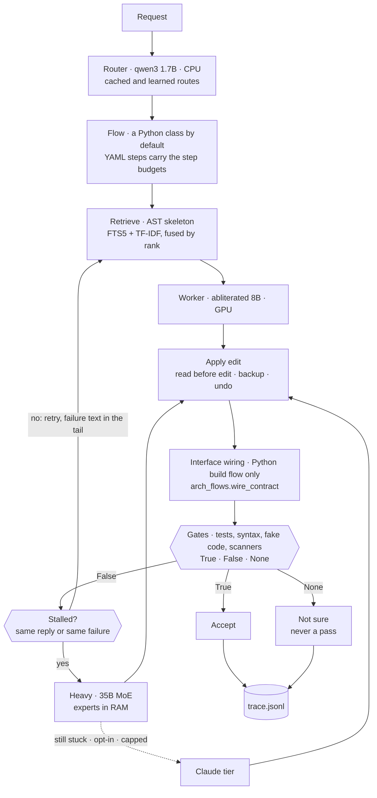
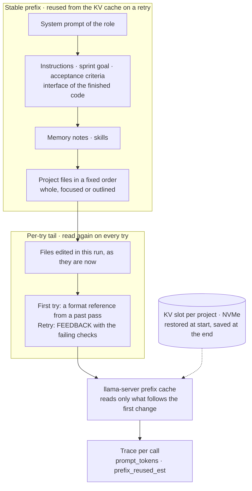
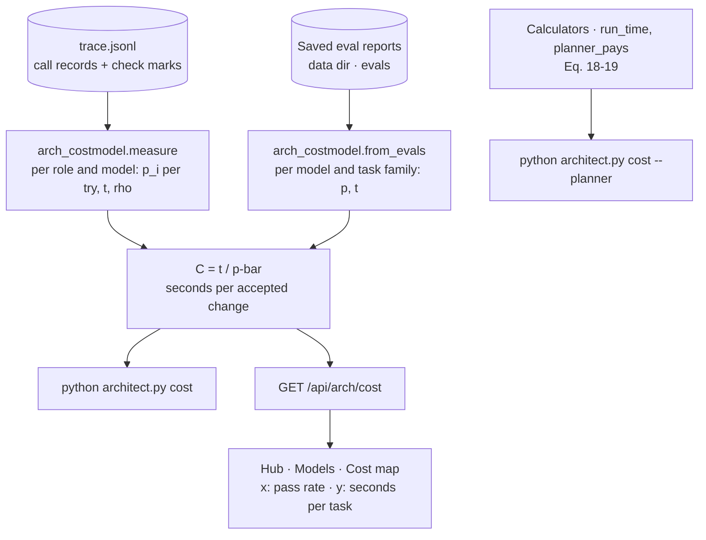
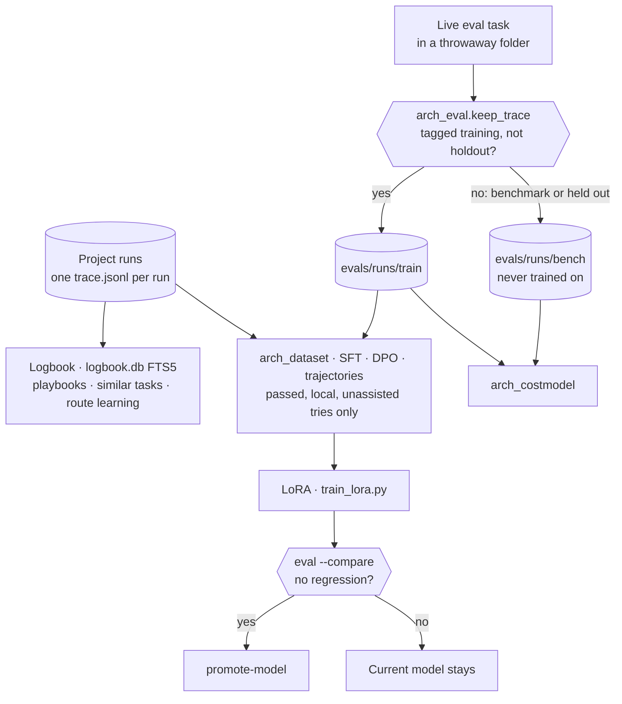
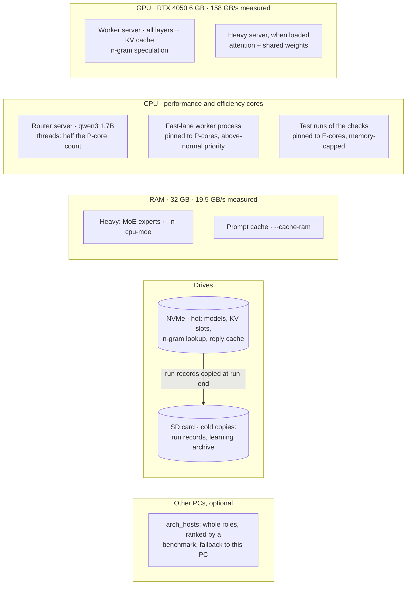

# Architect — architecture

Architect is a local-first agentic coding harness. Local models propose edits; code (tests, parsers, scanners) decides which
edits are kept; Claude is an optional, spend-capped tier that is off by default. This document maps the system one part at a
time: the run loop, the layers, the harness, the prompt and its caches, the cost model, data and learning, the agents, and where
each piece runs on the hardware. Each main part has one diagram and names the code that implements it.

Numbers are measured on the reference machine unless marked otherwise: an RTX 4050 laptop GPU with 6 GB (158 GB/s measured),
32 GB of single-channel RAM (19.5 GB/s measured), an Intel 13th-gen CPU with performance (P) and efficiency (E) cores, an NVMe
drive and a 32 GB SD card. Equation numbers refer to the [technical report](research/README.md).

| Tier | Model on the reference machine | Where it runs |
|---|---|---|
| router | `qwen3:1.7b` | CPU, with half as many threads as there are P-cores |
| worker | `huihui_ai/qwen3-abliterated:8b` | GPU: all 36 layers + 8K KV cache when the desktop leaves the card free; about 5.3 GB (plan estimate: 4.7 GB weights + 0.6 GB KV) |
| heavy | `eriktonon/qwen3.6-moe-uncensored:iq3`, a 35B mixture-of-experts with about 3.8B active per token | attention and shared weights on the GPU, experts in RAM (`--n-cpu-moe`) |
| cloud | a `claude:` model, optional | Anthropic, only when `online.cloud_tier` allows it |

---

## 1. The run loop

**A model proposes; code decides.** Every step ends in checks that return `True` (ran and passed), `False` (ran and failed) or
`None` (could not run). `None` makes the run's verdict *not sure*: never a pass, and never training data in either direction.
A small model is only trustworthy because code checks its work, so the gates are the product.

- **Router.** `arch_flows.route` asks the router model to pick the flow, with a keyword match and what past runs on this machine
  say (`arch_routelearn.suggest_for`) as labelled evidence; code checks the pick. A decision is cached in
  `<data>/route_cache.json` (500 entries, 30 days, off during eval and self-tests).
- **Flow.** Under the default `flows.engine = legacy`, the main flows (`build`, `bugfix`, `feature`, `refactor`, `test`, ...)
  run as Python classes in `arch_flows*.py`. They stop only at `limits.max_calls` (60 calls) or on a STOP file (`.arch/STOP` or
  `<data>/STOP`), both checked in `Engine.call` before each call. A YAML flow (§3) also gives each step a `{calls, tokens, seconds}`
  budget, enforced in `Engine.call` before a request leaves. Those step budgets apply under `flows.engine = data`, to the flows
  that exist only as YAML (`explore`, `fanout_review`, `scout_then_build`, `council_fix`, `plan_local_build`, `a11y`, `deps`,
  `document`, `harden`, `migrate`, `types`), and to local agents (`arch_localagent`).
- **Retrieve.** `Engine.context` builds the project context: memory notes (`arch_memory`), matching skills (`arch_skills`), then
  files ranked by `arch_index.Retriever` (SQLite FTS5 over functions in `arch_fts`, fused with TF-IDF by reciprocal rank,
  Eq. 23). The best files go in whole; the rest as an AST skeleton (`focus`: matching functions in full, other definitions as
  signatures; `outline`).
- **Apply.** FILE/EDIT/DEF blocks go through `Engine.apply`: a backup and an undo for every write, the shrink guard, and in tool
  loops read-before-edit (`behavior.ground_edits`).
- **Interface wiring.** New on 2026-11-05: in build sprints, code repairs missing package wiring before the checks (§3).
- **Gates.** `arch_gates.GATES` (the named gates a step may use), `verify` (syntax first, then tests), the fake-code detector,
  the scanners, and in build sprints `arch_flows.contract_check` (does the code expose the interface the request names). A judge
  model may score what code cannot decide; its verdict field is recomputed in code.
- **Retry.** The failure text goes at the end of the next prompt (§4). `arch_progress.Coach` fingerprints replies and failures
  (no change, repeated reply, same failure, cycling: Eq. 22). `BestState` undoes a try that clearly made things worse before the
  next one.
- **Trace.** Every call, check, mark, tool call, escalation and verdict is one line in `.arch/runs/<run>/trace.jsonl`. The
  receipt, the logbook, the dataset and the cost model all read it.

---

## 2. Layers

| Layer | What it does | Main modules |
|---|---|---|
| **Interface** | Hub (four places: Projects, Workspace, Models, Settings; Simple mode by default), CLI, Python API | `hub_ui.html`, `architect_hub.py`, `model_hub.py`, `architect.py`, `architect_embed.py` |
| **Orchestration** | Routing, flows as data, budgets, retries, stall detection, escalation, fleets, the work queue | `arch_flows*.py`, `arch_dataflow.py`, `arch_progress.py`, `arch_fleet.py`, `arch_supervisor.py` |
| **Engine** | Model calls, prompt assembly, retrieval, edits and undo, traces | `arch_core.py` (`Engine`), `arch_tools.py`, `arch_index.py`, `arch_fts.py`, `arch_memory.py` |
| **Verification** | Gate registry, tests, parsers, fake code, scanners, the interface check and wiring | `arch_gates.py`, `arch_gates_more.py`, `arch_checks.py`, `arch_fakecode.py`, `arch_deps.py`, `arch_flows.contract_check`, `arch_flows.wire_contract` |
| **Inference** | llama-server (Ollama as the fallback), the Claude tier, Claude Code, Managed Agents | `arch_transport.py`, `arch_server.py`, `arch_cloud.py`, `arch_claudecode.py`, `arch_agents.py` |
| **Hardware** | Detection, fit and placement plan, fast lane, idle unloading, other PCs | `arch_hw.py`, `arch_server.py` (`plan`), `arch_placement.py`, `arch_broker.py`, `arch_hosts.py` |
| **Measurement** | Fixed task sets, the regression gate, kept eval traces, the cost model, spend | `arch_eval.py`, `evals/`, `arch_costmodel.py`, `arch_costs.py`, `arch_receipt.py` |
| **Learning** | Logbook, playbooks, dataset, LoRA, routing that learns, flow iteration | `arch_learn.py`, `arch_overseer.py`, `arch_dataset.py`, `train_lora.py`, `arch_routelearn.py`, `arch_iterate.py`, `arch_autotune.py` |
| **Safety** | Offline seal, spend caps, secret scrubbing, file ownership, sandbox | `arch_cloud.allowed` / `reserve`, `arch_redact.py`, ownership hooks, `arch_sandbox.py` |

---

## 3. The harness

### Flows as data
A flow is a YAML file in `flows/`. Its steps have one of the kinds in `arch_dataflow.STEP_KINDS`: `generate`, `code`,
`ask_json`, `judge`, `doc`, `sample_n`, `cascade`, `chunked`, `foreach`, `tool_loop`, `report`, `handoff`, `sub_flow`. Each step
names a tier, a prompt file (`prompts/<flow>/*.md`), its gates, retries and a budget `{calls, tokens, seconds}`.
`flows.engine` decides who runs a flow: `legacy` (the default; the Python flow classes, with YAML filling only what they do not
provide), `data` (YAML wins) or `off`. So the step budgets bind only where YAML runs the flow (see "Flow" in §1). Blueprints (hub) and `architect.py flows --validate` save through the same validator.
Patterns encoded as flows: `fanout_review` (several reviewers, a judge keeps what survives), `scout_then_build` (a cheap local
step briefs the builder), `council_fix` (local tries, then a council), `plan_local_build` (a thinking tier plans, the local
worker writes).

### Interface wiring (new, 2026-11-05)
In 30 live whole-project builds (2026-11-04), about half of the failures were the shape of the contract, not its behaviour: a
package with no `__init__.py` or `__main__.py`, a name defined but never exported, a wrong module path or signature. The model
had written the logic and missed the wiring. An IDE handles this kind of error with a quick fix, and the harness now does too.

`arch_flows.wire_contract(e, goal)` runs in every build sprint after the reply is applied and before the checks. It reads the
interface the request states (`interface_contract`) and applies a fix only when exactly one fix is possible:

| When | Fix | Kept only if |
|---|---|---|
| a package folder the request names holds modules but no `__init__.py` | write a one-line `__init__.py` | the write is applied |
| `from pkg import name` fails and `name` is defined at the top of exactly one module `pkg/mod.py` | append `from .mod import name` to `pkg/__init__.py` | the import now works; otherwise the old bytes are written back |
| the request runs `python -m pkg`, there is no `pkg/__main__.py`, and exactly one module has a top-level `main()` that needs no arguments | write a `__main__.py` that runs that `main()` | `import pkg.__main__` works; otherwise the file is removed |

Each fix goes through the engine's normal write path (`put_file`: backup and undo; the person is asked unless review is
`auto`), and a dry run writes nothing. A name defined in two modules, a `main()` that needs arguments, or a package that is not
built yet is left to the model. A try that this helped is traced as type `assist`, and `arch_dataset` never exports it as a
training sample, even when it passed: the reply alone was not the right answer. `arch_selftest_wiring` replays the two live failures
(`build_report` never exported from `salesreport/report.py`; `python -m inventory` with the CLI in `inventory/cli.py` and no
`__main__.py`).

`arch_flows.contract_check(e, goal)` is the check that follows. It imports each name the request names, binds each named call's
arguments to the real signature without running it, and checks that `python -m pkg` has something to run. In the last sprint a
mismatch fails the sprint; in earlier sprints it is a note beside another failure. Both run in the Python build flow (`build`,
and `new`, `feature` and `ml`, which run its sprints). Neither is yet a gate in `arch_gates.GATES` or a step in
`flows/build.yaml`.

### What makes a small model finish (measured)
- **Ground before editing.** A line edit is refused until the model has looked at those lines in this run
  (`behavior.ground_edits`). Agents averaged about 5 reads per edit; blind edits miss.
- **Context editing.** In tool loops, old tool results are shortened in the prompt, so an 8K window holds a long exploration.
  The YAML tool loop keeps the newest 4 results in full, cuts the next 10 to 600 characters and older ones to their first line
  (`arch_dataflow._compact_turns`). A local agent keeps the newest 3 in full, cuts the next 7 to 600 characters and older ones
  to one line of 100 characters (`arch_localagent._history`). The third identical read of unchanged lines returns a pointer,
  not the text.
- **Big files.** The lines a request points at (quotes or rare words) are always shown (`Engine._quoted_lines`).
- **DEF blocks, interface first, one sprint per module, best try kept** (`core.replace_def`, `PLAN.interface`,
  `behavior.merge_small_plans`, `BestState`; see CLAUDE.md).
- **Checks ignore problems that predate the run**, so a correct one-line change is not failed for old findings.

### Escalation ladder
worker (local GPU) → heavy (local MoE) → Claude. A stalled step is handed to the heavy tier for the rest of that step only when
`arch_progress.ready_now` finds its server answering and its measured speed gives a ~1500-token answer within
`limits.escalate_max_s` (240 s). Claude is the last step, only when `online.cloud_tier` is `escalation`, `chat`, `plan` or `all`
and `arch_cloud.allowed()` agrees. In `plan` mode Claude does the thinking roles (planner, architect, judge, reviewer) and the
local models write the code.

---

## 4. The prompt and its caches

A retry re-sends the whole prompt. llama-server reuses its KV cache up to the first byte that changed, so the order of the
prompt decides what a retry costs.

Prompts are prefix-stable: every retry template puts the stable part first and the per-try part last.
`arch_selftest_chain` fails any retry template in the Python flow modules (`arch_flows`, `arch_flows_ci`, `arch_flows_fake`,
`arch_flows_pro`, `arch_flows_sec`) that puts `{feedback}` before the project context. `arch_selftest_promptprefix` checks the
YAML engine's 47 prompt files (`prompts/<flow>/*.md`) the same way: every per-try placeholder after every stable one. Within a run, `Engine.context`
keeps each query's first file order, adds new files at the end and moves the files being edited last, so everything before the
first edited file is reused. Before that order was pinned, re-ranking reshuffled the files on every retry and only 14–46% of the
repeated input was reused (measured). The format reference (a past reply of yours that passed, from `arch_ledger`) goes at the
end of the user turn on first tries only, never in the system prompt. When a prompt does not fit the served window, the format
reference is dropped first, then the end of the project context (`Engine._call`, `arch_tune.cut_context`).

Eq. 15 gives the time of one call when a share ρ of its $n_{in}$ prompt tokens comes from the cache:

$$t = (1 - \rho) \frac{n_{in}}{r_p} + n_{out} t_{tok}$$

The report's example is an 8k-token context followed by 300 tokens of feedback:

$$\rho = \frac{8000}{8000 + 300} \approx 0.96$$

A retry then re-reads about 4% of its prompt: the first term of Eq. 15 shrinks to that share, and the decoding term is
unchanged. ρ is measured, not assumed:
llama-server reports how many prompt tokens came from its cache (`cache_n`), and the trace records it per call as
`prefix_reused_est` beside `prompt_tokens`. The worker's KV slot is saved per project on disk at the end of a run and restored
at the start of the next (`arch_server.slot_io`, `--slot-save-path`), so the first answer after reopening a project skips
re-reading its context. The save runs after every run that made a model call, keyed by the folder's name. That includes live
eval tasks, whose throwaway folders have unique names: their slot files can never be restored, and nothing prunes them. A code
change to skip the save for eval runs is being made.

### Caches, in the order a call meets them

| # | Cache | Where | What a hit saves | Rule |
|---|---|---|---|---|
| 1 | Route decisions | `<data>/route_cache.json` | the router call | same request and folder state; off in eval |
| 2 | Local reply cache | `arch_cache.py` | the whole call | temperature 0 or a seed; never during eval |
| 3 | Claude reply cache | `<data>/cloud_cache/` | the whole call, free | 30 days; off in eval and self-tests |
| 4 | llama-server prefix (KV) cache | GPU memory, `--cache-ram` in RAM | re-reading the prefix | prompts are prefix-stable |
| 5 | KV slot per project | `--slot-save-path` on NVMe | re-reading after a reopen | saved at run end, restored at start; eval runs too, for now |
| 6 | N-gram lookup | `server/lookup` on NVMe | decoding of repeated text | edits 56 → 306–343 tok/s (measured) |
| 7 | Claude prompt cache | Anthropic | 0.9 of the input price | system and shared context first; Council agents share one prefix; 5 min or 1 h |
| 8 | Logbook retrieval | `<data>/logbook.db` | a cold start | similar past tasks and the tool sequence that worked |

**Measured on 2026-11-04:** about 107 M Claude input tokens were served from cache against a few thousand uncached; a 6-call
Council answer fell from 0.27 to 0.18 USD with a shared prefix. A new Claude Code session writes about 30–34K tokens of its own
system prompt and tools to the cache once (about 0.10–0.17 USD), so fewer, longer agent sessions are cheaper than many short
ones.

**Context budgets.** `Engine.context(budget)` counts outlines too. Local prompts are fitted to the window the server really
serves; Claude prompts get the full window. Local scouts hand Claude a ~600-word brief instead of the files.

**Money.** `arch_cloud.reserve()` holds the worst case before every Claude call, Claude Code run, fleet and Managed Agent, and
`settle()` records the real cost. Caps hold per run and per day. Fast mode runs only when a person waits. `arch_tokens` prices
a message before it is sent.

---

## 5. The cost model

The report judges a model, a role placement or a harness change by one number: the expected seconds per accepted change,

$$C = \frac{t}{\bar p}$$

where $t$ is the mean time of a try and $\bar p$ is the pass rate over tries $1, \dots, k$, each try weighted by the chance
$Q_{i-1}$ that the step is still open when it starts (Eq. 17). With a constant pass rate this is $C = t/p$ (Eq. 16). A model
twice as fast that passes half as often costs the same.

- **Per call** (`measure`). Reads the call records and the marks the checks wrote. Per role and model it estimates $p_i$ for the
  $i$-th try of a step, the mean $t$, the mean ρ, $C$, the first-try bound $t/p_1$ (the gap to $C$ is what feedback is worth)
  and energy $E = P C$ with `--watts`. A `None` mark and a reply replayed from a cache are not evidence and are left out. It
  reads the portfolio projects and both kept eval buckets (§6).
- **Per task** (`from_evals`). Reads saved eval reports (`<data>/evals/*.json`, oracle reports skipped) and groups tasks by the
  model that made most of the calls and by task family (`e2e`, `distributed`, `bugfix`, ...), not by flow: one flow serves
  families of very different difficulty. $p$ is passed over decided tasks; a not-sure task is left out of $p$, but its seconds
  still count. $C$ is total seconds over passed tasks.
- **Cost map** (hub **Models → Cost map**, `costmapPage`). Each (model, family) is a point at (pass rate, seconds per task). All
  points with the same cost lie on the ray $t = C p$ through the origin; the dashed rays mark 1, 2, 4, 8, 16 and 32 minutes per
  accepted change, where they fit the plot. Lower right is better. Orthogonalized models are filled circles, others squares;
  the best point per family is ringed; a trail shows how a point moved across saved runs; a click lists the tasks behind it.
  The page only shows numbers: it never assigns a model.
- **Placement calculators.** Eq. 18 (run time $J$ of a role assignment with swaps) and Eq. 19 (does a larger planner pay?) are
  `arch_costmodel.run_time` and `planner_pays`. Self-tests reproduce the report's worked example: 150 s > 110.8 s pays, 83.3 s
  < 110.8 s does not. No run applies them automatically yet.

The current readings are in the [README](../README.md) and [IMPLEMENTATION_STATUS.md](research/IMPLEMENTATION_STATUS.md). They
are small samples (3–6 tasks per cell). The clearest result so far: no model has passed a whole-project build (0 of 4 each),
and that is the failure the interface wiring targets.

---

## 6. Data and learning

- **Kept eval traces** (new, 2026-11-05). A live eval task runs in a temporary folder that is deleted afterwards.
  `arch_eval.keep_trace` copies its run record first, to `<data>/evals/runs/train/.arch/runs/` when the task is tagged
  `training` and not `holdout`, or to `.../bench/` otherwise (benchmark families and held-out training tasks). `train` is the
  only eval bucket `arch_dataset.roots` reads. `bench` is read by the cost model and never trained on, so the benchmark cannot
  learn its own answers. Oracle runs (`eval --fake`) keep nothing; each bucket keeps its newest 1000 runs.
- **Dataset** (`python architect.py dataset`, `arch_dataset.py`). Writes SFT, DPO, distillation and trajectory sets per role
  and per tier to `<data>/datasets/`. A sample is exported only when the checks ran and passed. Left out: Claude replies
  (transport `claude`), tries that passed with wiring help (`assist`), `None` marks, anything that looks like a credential, and
  samples too long for a small card. Replies replayed from a cache are left out of the SFT and DPO sets, but the trajectory set
  does not filter them yet. A DPO pair uses the first try's prompt (the clean task), because that is the prompt the model sees
  next time.
- **Training and promotion.** `train_lora.py` fine-tunes the worker tier with QLoRA on that export; its curation is self-tested,
  and a second check drops anything a cloud model made. `eval --compare` is the regression gate, and `promote-model` switches a
  tier only when the new model is no worse on the fixed task set.
- **Logbook.** Project runs and agent logs feed `logbook.db` (`arch_learn`, `arch_overseer`): playbooks, similar past tasks with
  the tool sequence that worked, and the learning router. Claude-made tasks (`by_claude`) serve analysis and retrieval, never
  weights (`exclude_from_training()`).
- **Training workload.** 105 tasks with hidden tests: 65 distributed-systems and 40 harness-building tasks
  (`evals/families/distributed.py`, `harness.py`; run overnight by `tools/train_traces.py`). One variant per template (21 in
  all) is tagged `holdout`. `tools/train_traces.py` runs those too, but `keep_trace` files them in the bench bucket, so they are
  never trained on. To measure an adapter on them, run `eval --tags holdout --n 65`. Without `--n`, each of these families
  generates a single task (`DEFAULT_N = 1`, variant 0) and the held-out variant is index 4, so the filter selects nothing.
- **Agent work from building the app:** `hub_data/learning/` (briefs, scrubbed logs, ledger, reasoning corpus, METHOD,
  LESSONS) and the SD-card archive `D:\Architect\learning\` (`tools/sync_learning.py`).

---

## 7. Agents

| Agent type | Runs where | Billed | Module |
|---|---|---|---|
| Local agent (tool loop on local models) | this PC, GPU worker | free | `arch_localagent.py` |
| Claude Code (Agent SDK) | this PC, project folder | API key, never a subscription (own `CLAUDE_CONFIG_DIR`) | `arch_claudecode.py` |
| Managed Agent (Anthropic sandbox) | Anthropic | API key | `arch_agents.py` |
| Council (solver, critic, alternative, 2 skeptics, lead) | Claude API | API key | `arch_cloud.ultra` |
| Subagents (code-reviewer, test-writer, yours) | inside Claude Code | API key | `<data>/subagents.json` |

**Fleet method (lead + workers).** `arch_fleet.py` runs many agents at once. Each owns its files (`plan_check` refuses overlaps,
and a PreToolUse hook denies writes outside them), each has a spend cap, local agents take turns on the one GPU while CPU and
Claude work run in parallel, and **the fleet, not the agents, runs the tests** (`ALLOWED_PREFIXES` only, below-normal
priority). Briefs that worked are templates in `agent_templates/` (`arch_agentlib.py`), each marked whether a local worker can
do it.

---

## 8. Hardware placement

README's "where the bytes live" shows which memory holds which weights. This view adds which process, core and drive does
which job.

| Part | Role | Code |
|---|---|---|
| GPU | the worker, all layers on the card when the desktop leaves room (the plan subtracts what the card already holds and otherwise splits the layers); the heavy tier's attention and shared weights when it is loaded | `arch_server.plan` (fit math, Eq. 4–5), `_moe_split` |
| P-cores | in the fast lane, the worker process (pinned, above-normal priority); the router runs with half as many threads as there are P-cores (its process is not pinned) | `arch_server.plan`, `perf_mask`, `arch_hw.perf_cores` |
| E-cores | test runs during a run (pinned, inside a Job Object with a memory cap), so the test runner never competes with a model server | `behavior.tests_on_ecores`, `arch_hw.pin_to_ecores`, `arch_sandbox.py` |
| RAM | the heavy tier's experts; the prompt cache | `--n-cpu-moe`, `server.cache_ram` |
| NVMe | models, KV slot files, the n-gram lookup cache, the reply cache, live databases; never the SD card for models | `arch_hw.drive_roles` |
| SD card (`D:`) | cold copies: each run's `run.json`, `trace.jsonl` and `report.md`; the learning archive. No backups go there: edit backups stay in each project's `.arch/`, self-improve zips beside the app. | `storage.archive` (`arch_archive.py`), `tools/sync_learning.py` |
| Other PCs | whole roles; only prompts and replies cross the network | `arch_hosts.py`, `role_hosts`, hub **Models → Computers** |

The card reads weights about 8 times faster than RAM here (158 against 19.5 GB/s, both measured), which is why the worker
stays whole on the card and only the heavy tier's sparse experts live in RAM.

- **Fast lane** (`server.fast_lane`, on here). The worker gets the whole card: every layer and the whole KV cache (the window
  shrinks to fit, not below `FAST_MIN_CTX` = 6144), n-gram speculation, a lower thinking budget, and above-normal priority on the
  P-cores. The heavy tier does not sit beside it.
- **Heavy beside the worker** (`server.heavy_beside`, off here). The MoE heavy stays loaded next to the worker with its experts
  in RAM. Measured: the heavy writes 14–16 tok/s, and switching takes about 1 s instead of 15–20 s.
- **Free memory when idle** (`server.idle_free_min`, default 15 minutes). Idle model servers and Ollama copies are unloaded and
  reload on demand in about 5–8 s.
- **One heavy job at a time** (`arch_heavy.py`). `selftest`, `eval`, `livetest`, `tune` and `self-improve` take an OS file lock
  and run at below-normal priority.
- **Built, not yet wired into runs.** `arch_placement` computes the whole placement from measured facts, including background
  chores (indexing, logbook ingest, scans, exports) on the E-cores at below-normal priority (`run_low`). `arch_broker.route`
  picks a target per job (GPU worker, heavy, CPU router, E-cores, Claude, or wait) from measured speed, load, money caps and a
  local-first policy, and logs the reason to `hub_data/broker.jsonl`. Both are self-tested pure functions; no run calls them
  yet.

---

## 9. Safety and privacy
- Offline by default: anything the harness itself fetches, and every Claude call, sits behind `online.enabled`, and code the
  harness runs gets `behavior.network = offline`. Model calls go only to this machine or to other PCs you added in `hosts`; a
  role routed to another PC (`role_hosts`) sends its full prompt there, project code included, whatever `online.enabled` says.
  `arch_selftest_offline` fails on the first connection that leaves the machine. Self-tests can never reach a paid model
  (`arch_cloud.allowed`).
- Run traces are stored as written: `.arch/runs/<run>/trace.jsonl` keeps every prompt and reply, including any secret that
  appeared in the project's files, and `storage.archive` copies it unchanged to the archive drive. Secrets are scrubbed
  (`arch_redact.py`) only from the learning archive (`tools/sync_learning.py` and the keeper in `hub_data/learning/`), and
  training exports drop any sample that looks like a credential (`arch_dataset.has_secret`). The API key lives only in the
  environment.
- Every edit has an undo; settings writes are checked and undoable; agents cannot write outside their own files.
- Tests of model-written code run through `core.run_bounded`: a hard wall-clock limit, and a Windows Job Object with a memory
  cap (`arch_sandbox.py`, `behavior.sandbox_mem_mb`) that stops everything the test started.

---

## 10. Where to look next
- [docs/research/README.md](research/README.md): the technical report and its section-to-code map (cost model `C = t / p̄`,
  memory hierarchy, orthogonalized models).
- [docs/research/IMPLEMENTATION_STATUS.md](research/IMPLEMENTATION_STATUS.md): what is built, partial or not yet built,
  equation by equation, with the current measurements.
- `CLAUDE.md`: developer rules and measured lessons. `docs/architecture_review_20261104.md`: 22 ranked improvements.
  `docs/claude_to_local_synthesis.md`: what Claude's agents did and how it applies locally. `docs/pc_plan_20261104.md`: this
  machine.
